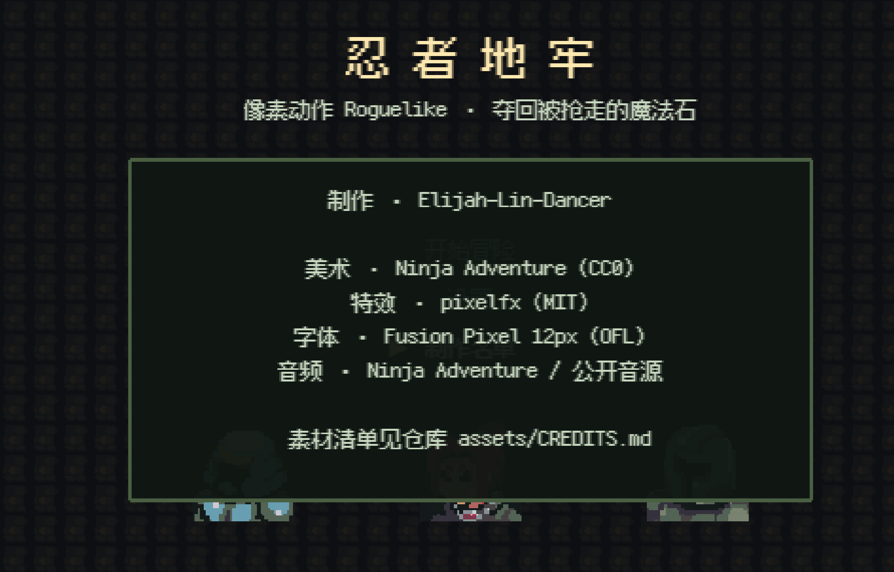
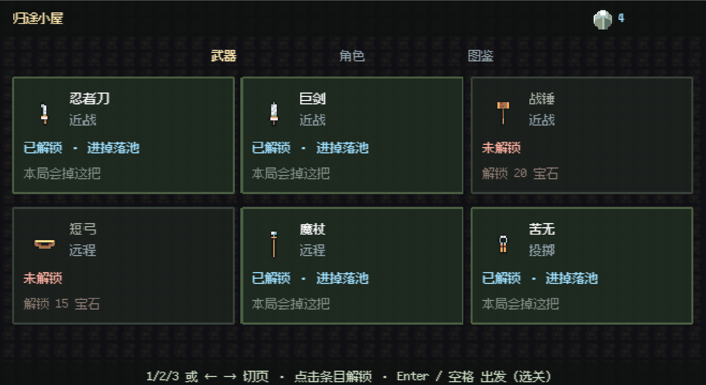
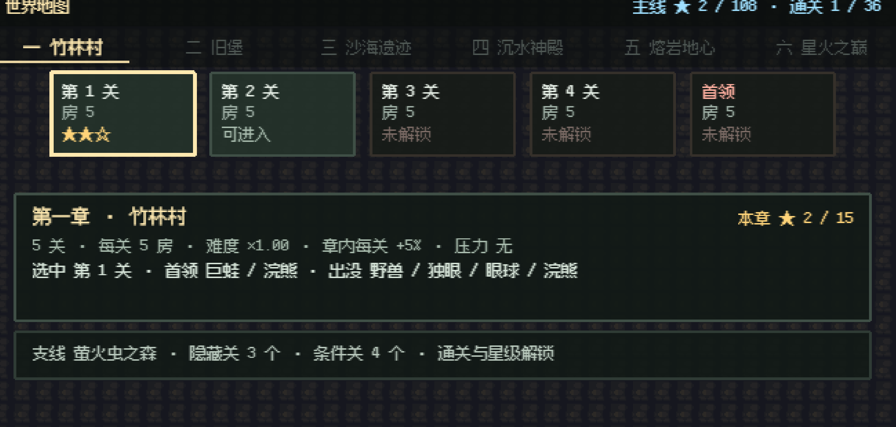
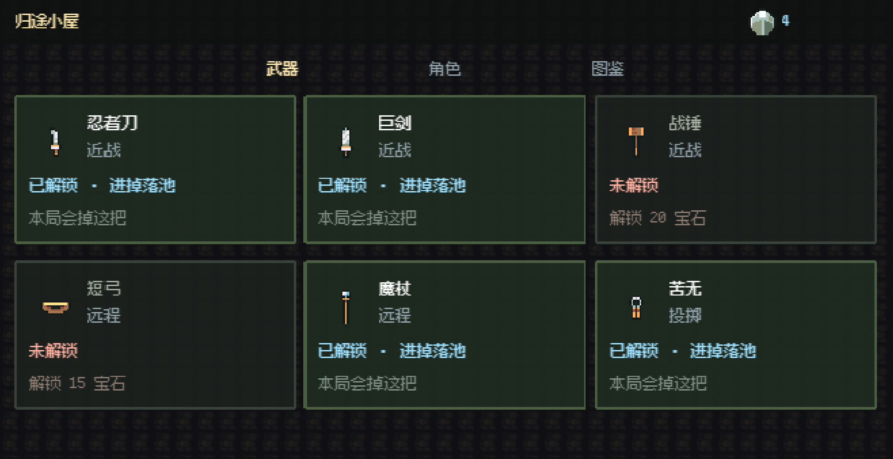
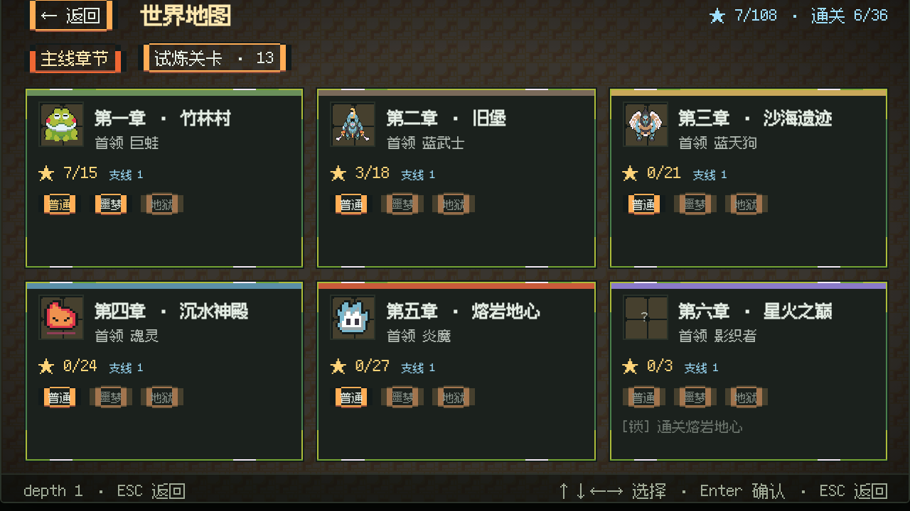
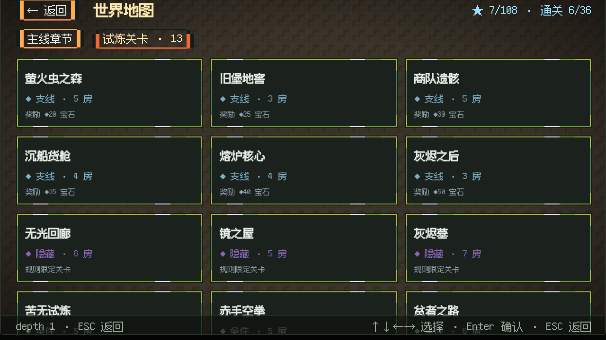
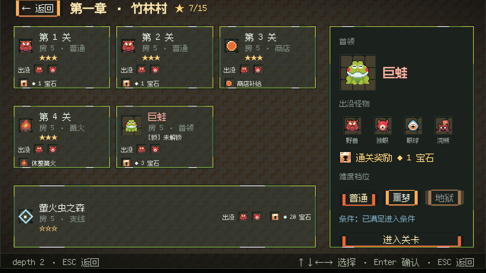
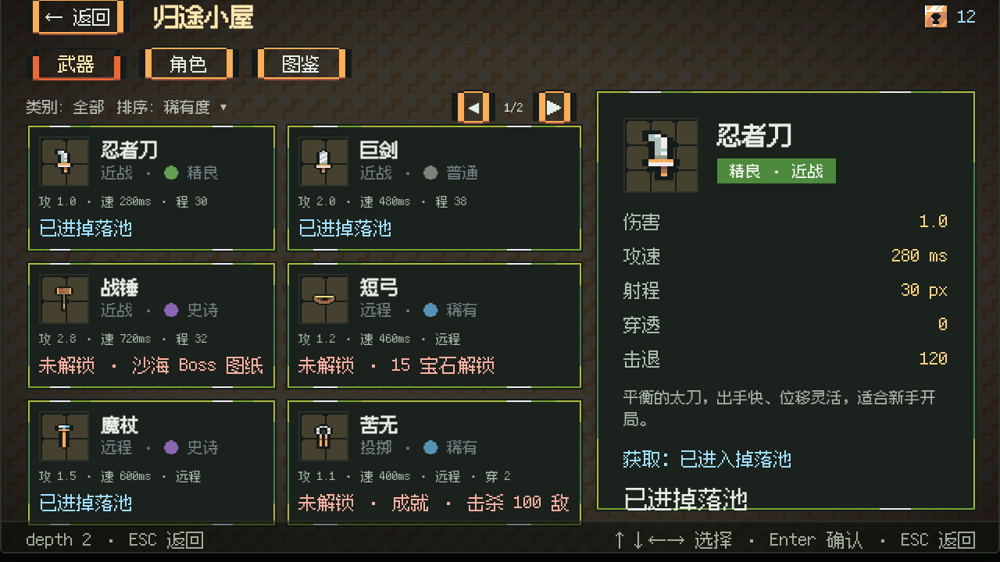
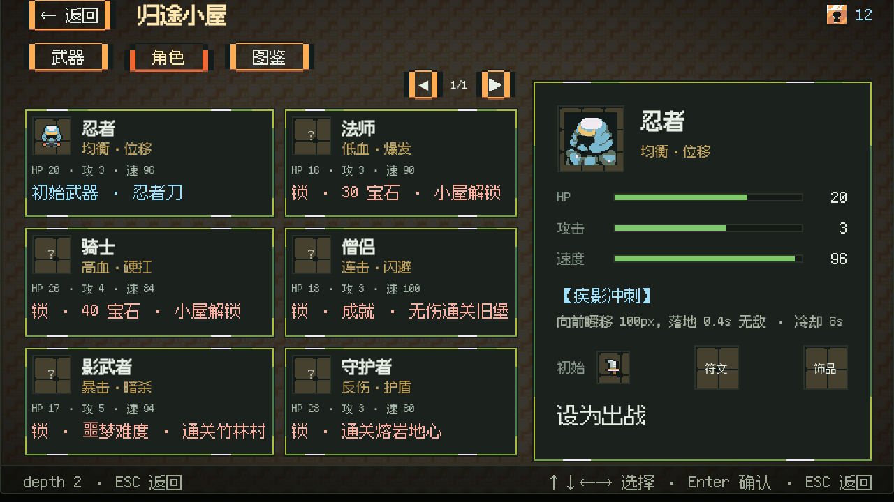

# 《忍者地牢》· UI/UX 与内容体系改造方案

> 命名基线：游戏工作名为 **《忍者地牢》**；`Ninja Adventure` 是 CC0 美术包名，只用于素材署名，不作为游戏标题。正式品牌名待定；定名后统一替换 `index.html`、`title.js`、`README.md` 与本方案封面。
>
> 基线：`game-repo` commit `f8d4a22`（批 12B 终章星火之巅），线上 https://elijah-lin-dancer.github.io/game-dev/ ；Phaser 3.80.1，逻辑分辨率 640×360，esbuild 单文件包，键盘 + 触屏双输入，中文 12px 像素字体。
> 边界：本轮只出方案，不写代码、不改线上、不碰开放世界 G0、不动终章平衡。现有资产：3 角色 / 6 武器 / 25 怪 / 11 Boss；关卡口径 **36 主线 + 6 支线 + 3 隐藏 + 4 条件 = 49 个关卡条目，主线满星 108**。
> 检索日期：2026-11-22。本方案与 `game-repo/docs/REVAMP-PLAN.md` 逐字一致，仅图片相对路径前缀不同。

---

## 0. 摘要与结论

**结论先行：当前 10 个问题分属三类病灶——导航无状态机（#1 #2 #4 #5）、难度模型错位（#3）、内容与视觉体系单薄（#6 #7 #8 #9 #10）。第一刀只切导航，先把"卡住玩家、违背直觉"的链路一次修通；内容扩张与视觉组件分批跟进，不先做零散补丁。**

| # | 核心判断 | 对应问题 |
|---|---|---|
| 1 | 导航病灶是"无返回栈 + 收藏层挡在冒险主入口前"。主流程应改为 Title→Map→关卡详情→Play；Hall（收藏小屋）降为二级页，从 Title 与 Map 两个侧入口进入，来路压栈、返回 pop 回来源。 | #1 #2 #4 #5 |
| 2 | 难度从全局 options 二档拆为**按章节解锁**的普通 / 噩梦 / 地狱三档，入口挂在关卡详情面板内；普通难度计入全部解锁进度，避免高难卡关死锁。 | #3 |
| 3 | 内容先复用现有素材做"少而深"：补齐稀有度 / 渠道 / 权重 / 装备位字段，把掉落与解锁条件上墙；新角色、新武器、装备实体归入 P2，不承诺无法落地的海量内容。 | #6 #9 #10 |
| 4 | 视觉潦草不是像素风的错，是缺设计令牌与可复用组件层。本轮**不重画 UI**：接入 Theme1 已有 20 个现成切片 + 整数缩放 + 字号阶梯 + 卡片五态；新美术仅可选"稀有度角标（4×16×16）"。 | #7 #8 #9 #10 |
| 5 | 49 个关卡条目中 13 个特殊关卡（支线 6 / 隐藏 3 / 条件 4）数据已存在但不可达；地图页改造必须先打通数据通路，否则它们继续是摆设。 | #8 |

**第一刀（P0，1 人日内可上线）**：先落 `src/systems/nav.js`（约 80 行：场景注册表 + 返回栈 + 覆盖层管理），再让 title / hall / map / select 接入 ESC / 右键 / 返回按钮，并重定向"开始冒险→Map"。预期解决 **#1 #2 #4 #5**，并附带消除 #7 中"返回行为不一致"的观感问题。**为什么不先做单独补丁**：现状返回目标全部硬编码（`map.js:224`、`play.js:3852`、`play.js:4104/4123`），逐场景打补丁会让下一个页面继续复制死胡同；先立规则层，再接线，改动一次到位、可回滚。

---

## 1. 现状：信息架构与问题证据

**结论：现状是 6 个场景的单向 `scene.start` 链，没有返回栈、没有父子层级登记；制作名单与 Hall、Select 均为死胡同；收藏经营页被放在冒险主入口的第一落点。**

### 1.1 现状场景转移图谱

| # | 调用点 | 目标 / 动作 | 证据 |
|---|---|---|---|
| 1 | `scene.start('play', {char})` | Play（`?char=` 调试直达） | `src/scenes/boot.js:227` |
| 2 | `scene.start('title')` | Title（冷启动默认） | `src/scenes/boot.js:228` |
| 3 | `scene.start('hall')` | Hall（Title「开始冒险」） | `src/scenes/title.js:103` |
| 4 | 同场景覆盖层 | 设置面板（非场景跳转） | `src/scenes/title.js:113-130` |
| 5 | 同场景覆盖层 | 制作名单（非场景跳转） | `src/scenes/title.js:178-196` |
| 6 | `scene.start('map')` | Map（Hall 内 Enter / 空格） | `src/scenes/hall.js:112` |
| 7 | `scene.start('hall')` | Hall（Map 按 ESC） | `src/scenes/map.js:224` |
| 8 | `scene.start('select', {stage})` | Select（Map 选中关卡） | `src/scenes/map.js:249` |
| 9 | `scene.start('play', {char, stage})` | Play（Select 确认角色） | `src/scenes/select.js:171` |
| 10 | `scene.start('hall')` | Hall（Play 暂停 H「回小屋，本局作废」） | `src/scenes/play.js:3850-3853` |
| 11 | `scene.start('map', overlayBack)` | Map（Play 死亡 / 通关结算） | `src/scenes/play.js:4104`、`4123` |
| 12 | `this.scene.restart()` | Play 重开本局（无 spec 老模式） | `src/scenes/play.js:3997`、`4102`、`4123` |

场景注册表顺序：`src/main.js:42` `[Boot, Title, Hall, MapScene, Select, Play]`；全仓库未出现 `scene.stop`。

### 1.2 可达性矩阵与死胡同

| 从 ＼ 到 | Title | Hall | Map | Select | Play |
|---|---|---|---|---|---|
| Title | — | ✅ 去；回 Title 无独立返回，覆盖层靠再点同项关闭 | ❌ | ❌ | ❌ |
| Hall | ❌ **回不去（死胡同 D2）** | — | ✅ 去；回 Hall 无入口 | ❌ | ❌ |
| Map | ❌ | ✅ 去/回 | — | ✅ 去；**回 Map 无入口（死胡同 D3）** | ❌ |
| Select | ❌ | ❌ | ❌ **回不去（死胡同 D3）** | — | ✅ 去；回 Select 无 |
| Play | ❌ | ✅ 去（暂停 H，本局作废） | ✅ 去（结算） | ❌ | ✅ 重开 |

| 编号 | 死胡同 / 异常 | 证据 | 玩家实际感受 |
|---|---|---|---|
| D1 | Credits 覆盖层无返回：只能再点一次「制作名单」toggle 销毁；ESC 分支只处理 settings；无返回按钮、无遮罩关闭 | `title.js:179`、`title.js:86`、`title.js:195` | 弹窗压在标题上，键鼠都只能再点原菜单 |
| D2 | Hall 无回 Title 路径：`bindKeys` 无 ESC、无返回菜单项；`start()` 唯一出口跳 Map | `hall.js:95-103`、`hall.js:110-113` | 进了「归途小屋」只能继续往地图走 |
| D3 | Select 无回 Map 路径：键位只有方向键 / 确认；未解锁角色只弹 toast，不提供跳转 | `select.js:82-87`、`select.js:165-167` | 选关后反悔只能放弃本局绕回 Hall |
| D4 | Play 暂停只有「继续 / 回小屋（本局作废）」：无回标题、无重选关卡 / 角色、无退出到地图 | `play.js:3835-3847`、`play.js:4102` | 进错角色 / 关卡只能放弃本局 |
| D5 | Map 解锁失败仅 toast：章节 / 关卡未开只提示前置条件，无相邻推荐、无跳转 | `map.js:148-159`、`map.js:201-206`、`map.js:242-245` | 卡在锁定项上只能自己查条件 |
| D6 | 调试直达 `?char=` 绕过 Title/Hall/Map；正式玩家不可见，上线前需确认是否移除 | `boot.js:226-227` | 待确认（技术债 T12） |

### 1.3 十问题证据表（#1–#10）

| # | 现象 | 代码位置（文件:行号） | 根因（一句话） | 最小修复点 | 牵动文件 |
|---|---|---|---|---|---|
| 1 | 制作名单页无法返回 | `title.js:178-196`（179 行 toggle 销毁）；ESC `title.js:86` 仅 `closeSettings`；容器 `title.js:195`；无返回按钮 / 遮罩 | Credits 被当成"再点一次开关"，没有独立返回动作与键位 | 覆盖层补返回动作（ESC / 右键 / 遮罩 / 按钮），销毁后恢复主菜单焦点 | `title.js` |
| 2 | 「开始游戏」页（Hall）无法返回上一级 | `hall.js:95-103`（bindKeys 无 ESC / 返回）；`hall.js:110-113`（唯一出口 `scene.start('map')`）；全文件无 `scene.start('title')` | Hall 被设计成单向前进的大厅，没有上一级概念 | Hall 补返回动作与键位 / 按钮，在导航规则里登记 Hall 父级（来源动态压栈） | `hall.js`；新增导航层 |
| 3 | 难度是全局设置，应按章节通关解锁噩梦 / 地狱 | 选项 `options.js:10`（`normal\|hard`）；解析 `options.js:19`；乘区 `options.js:33-37`（困难 血×1.25、伤×1.2）；消费 `play.js:33/867/939/3868`；章内递进 `stages.js:51-53`；存档无难度字段 `save.js:8-26` | 难度挂在全局 options 上，没有"按章 / 按进度解锁的档位"数据模型 | 档位拆到章节 / 关卡维度，存档记录各章解锁与通关；乘区按当前关取档 | `options.js`、`play.js`、`stages.js`、`save.js`、`chapters.json` |
| 4 | 点开始后先进武器 / 角色 / 图鉴，要再点 Enter 才选关 | 链路 `title.js:103`→`hall.js:112`→`map.js:249`→`select.js:171`；Hall 三页签 `hall.js:15`；脚注自相矛盾 `hall.js:90`；Select 角色确认 `select.js:45-88` | 收藏 / 经营层放在主流程第一落点，选关被挤到第三层 | 主入口上提：Title 之后直达 Map；Hall 降为二级收藏页，从 Map 或 Title 侧边进入 | `title.js`、`hall.js`、`map.js`、`select.js`、`main.js:42` |
| 5 | 页面切换与上下级关系整体不合适 | 跳转见 §1.1；无返回栈（grep 无 stack/history）；返回目标硬编码 `map.js:224`、`play.js:3852`、`play.js:4104/4123`；Select/Hall/Title 间无父子登记 | 点对点硬编码跳转，缺统一层级定义、返回栈与"上一级"解析规则 | 建导航状态机 / 返回栈：登记父级与返回动作，ESC 统一回上一级，替换硬编码目标 | 全部场景；新增导航层 |
| 6 | 角色 / 武器不该只有固定几个，要有闯关 / 抽取 / 装备等多样获取 | 角色白名单 `chars.js:4`，归一化丢弃白名单外 id `chars.js:13`；存档白名单 `save.js:40-45`；武器白名单 `save.js:58-64`；武器仅 6 条 `weapons.json`；唯一渠道=宝石购买 `hall.js:16`、`hall.js:258-275`；选人页价格另写一份 `select.js:8`；掉落均匀随机 `weapons.js:64-68`；无装备槽 / 锻造 / 成就渠道 | 内容模型只有"已解锁 / 未解锁"布尔 + 价格，缺稀有度、渠道、权重、装备位与跨局成长 | 数据层扩字段；解锁渠道从单一购买扩到闯关掉落 / 成就 / 锻造；白名单改数据驱动 | `chars.js`、`weapons.js`、`save.js`、`hall.js`、`select.js`、`play.js`、`chars.json`、`weapons.json`、新装备数据 |
| 7 | 所有页面设计太简陋，2D 像素风不等于潦草 | 无组件层（grep `class .*UI\|extends Phaser.GameObjects` 无命中）；各场景内联 `add.rectangle/add.text`：`title.js:63-79`、`hall.js:132-201`、`map.js:80-141`、`select.js:90-119`；硬编码色值散落；raw UI 套件未入图集；字体规格被打破 | 视觉是逐场景手写矩形 + 文字，没有设计令牌与复用组件，现成素材未接入 | 先定全局视觉规范与可复用组件，再逐场景替换内联绘制 | 全部场景、`tools/build.mjs`、`web/atlas/core.json`、新组件层 |
| 8 | 关卡选择页（Map）太粗糙 | 节点布局 `map.js:104-141`（`perRow=min(5,n)` 109、`w=104` 111、`h=54/60` 112、`gap=12` 113、`top=64` 114）；卡内三行小字 `map.js:130-138`；章面板 `map.js:80-91`；无章节图 / 路径 / 分支；特殊关卡仅文字 `map.js:195-198` | 等宽矩形网格 + 纯文字，缺章节辨识度、关卡氛围与可浏览的进度结构；13 个特殊关卡不可达 | 重排地图信息层级（章节头图 / 节点路径 / 关卡卡要素 / 锁定条件可视），打通特殊关卡入口 | `map.js`、`chapters.json`、图集素材 |
| 9 | 武器页粗糙 | `hall.js:132-167`（3×2，`colW(3,8)` 135、`CH=108` 136、`rowH=122` 137、`slice(0,6)` 138）；图标 `x+30,y+34` scale 1.5（144）；名称 145、类型 148、状态行 151、价格行 156；卡片**不展示**伤害 / 攻速 / 射程 / 穿透；无稀有度色 / 筛选 / 排序 / 对比 / 详情 | 卡片只有图标 + 名字 + 类型 + 状态，信息层级浅，战斗数值不上墙，6 张写死 | 武器卡补数值 / 稀有度 / 获取途径与详情态，布局改数据驱动列表 | `hall.js`、`weapons.json`、`weapons.js` |
| 10 | 角色页粗糙 | `hall.js:170-201`（3 卡，高 240（180）；立绘 `y+62` scale 1.5（182）；名字 183；属性仅一行 HP/攻/速 186-191；技能名 / 描述不上墙；无装备 / 成长入口） | 角色卡数值密度低，技能与定位卖点没呈现，无构筑 / 成长空间 | 角色卡补标签 / 技能 / 属性对比 / 装备位与详情态，列表数据驱动 | `hall.js`、`chars.json`、`chars.js`、`select.js` |

### 1.4 改造前截图对照

| 截图 | 文件（revamp 视角） | 对应问题 | 画面事实 |
|---|---|---|---|
| S1 | `revamp/img/3DFtZt0tjm.png` | #1 | 标题页「制作名单」深色弹窗，无返回按钮 / 提示；主菜单文字压在弹窗后隐约可见 |
| S2 | `revamp/img/3rAsnVZO9K.png` | #2、#9 | 归途小屋·武器页：3×2 六卡，右上角宝石 4；底部脚注「1/2/3 或 ←→ 切页 · 点击条目解锁 · Enter/空格 出发（选关）」；无返回标题入口 |
| S3 | `revamp/img/EyfNBAkKUQ.png` | #8 | 世界地图：六章页签，第一行五张关卡矩形卡，下方章面板；底部支线 / 隐藏 / 条件一行文字；主线 ★2/108 · 通关 1/36 |
| S4 | `revamp/img/AbaFcxJLVY.png` | #2、#9、#10 | 归途小屋武器页另一帧（同 S2 布局），旁证角色 / 武器页同在 Hall 三页签内 |









---

## 2. 市场怎么做（对标）

**结论：15 款同类 / 相邻作品在"导航层级、章节选关、收集经济、难度分层、像素视觉"五个维度收敛出同一套模式——主入口只放冒险、收藏经营是二级场所、每个覆盖层有独立返回、难度是通关解锁的阶梯、内容先进池再多渠道获取。本作只迁移模式，不抄皮。**

### 2.1 总对标矩阵

> 复核状态：**已存活**＝200 或经 web_fetch 抓取复核；**反爬但存活**＝403/429 反爬，页面可访问；**社区旁证未复核**＝仅社区帖支撑、未独立复核（本方案事实不依赖该类来源，故附录不收录其链接）。来源编号见附录 A。

| 游戏 | 年份 | 平台 | 解决问题 | 关键做法 | 可否迁移到本作 | 来源 | 复核状态 |
|---|---|---|---|---|---|---|---|
| Hades | 2020 | PC / 主机 | #1 #2 #4 #5 #6 | 主菜单只放 Play/Options；局外 House 统一承载选人 / meta 消费 / 武器院；死亡回 House 不回标题；暂停菜单 Continue/Settings/Give Up/Quit 分层显式；6 武器 × 多形态 + 信物；meta 资源按消费点分工 | 部分：借"hub 统一承载 + 死亡回 hub + 暂停分层"；不搬走动叙事 hub、多存档槽 | S01–S15 | 已存活 |
| Dead Cells | 2018 | PC / 主机 / 移动 | #1 #3 #4 #6 | 起始区兼 hub，BSC 1–5 通关终局 Boss 后逐档注入，管子在区内注入 / 卸下、过门锁定；蓝图带回收藏家解锁进池；高 BSC 挂钩新区域门与装备等级 | 部分：借"逐档解锁难度 + 蓝图进池"；不搬符文门路线网、5 档深度、百级武器池 | S16–S28 | 已存活 |
| Enter the Gungeon | 2016 | PC / 主机 | #1 #2 #4 #6 | Breach 一处承载选人 / 分类商店 / 教程门 / 捷径房 / 模式 NPC；选人在 hub 内自由换选，进塔才锁定；Credits 与商店 NPC 分类清晰；枪有五档品质与协同标识 | 部分：借"hub 分区 + 进塔锁定 + 商店解锁进池"；不搬走动实景、本地双人 coop、大池协同网络 | S29–S39 | 已存活 / 反爬但存活 |
| Risk of Rain 2 | 2019 | PC / 主机 | #1 #4 #6 | 开局决策（角色 / 难度 / 遗物）压缩在同一选人屏；角色靠挑战条件解锁；难度开局前选择，部分版本局中可改；Bazaar 是局内岔路商店而非顶层页 | 部分：借"开局决策同屏 + 条件解锁上墙"；不搬在线大厅、长局滚动、时间难度时钟 | S40–S42 | 已存活 |
| Soul Knight | 2017 | 移动 | #4 #6 #9 #10 | 大厅是 hub 而非开打必经页，大门在场景主位；武器地牢内拾取，同一武器重复拾取计数后永久解锁锻造；角色多渠道（商店 / 合成 / 成就 / 锻造）；角色卡三条属性 + 初始武器 + 技能图标 | 部分：借"重复拾取计数解锁锻造 + 卡片信息压缩"；不搬付费角色、概率扭蛋、400+ 武器池 | S43–S46 | 已存活 |
| Archero | 2019 | 移动 | #4 #6 #8 #9 | 主界面即章节节点路径，点节点直接进场；英雄 / 装备是侧边管理页不挡路；章节双模式 Normal / Hero；装备 9 槽环绕、8 档稀有度色块；重复装备合成升阶、金币 + 卷轴强化 | 部分：借"节点路径 + 锁形图标 + 当前关高亮 + 稀有度色块"；槽位压到 2–3 个；不搬付费宝箱、200+ 章 | S47–S54 | 已存活 / 反爬但存活 |
| Gunfire Reborn | 2021 | PC / 移动 | #3 #4 #6 #8 | 幕 + 难度两级选择；三档难度通关当前档后解锁更高档，难度挂在幕 / 关卡上而非全局开关；双货币分层（精魄永久 sink / 铜币局内清零）；藏宝室裂隙是关卡内可选支线 | 部分：借"幕 + 难度绑定 + 双货币分层 + 支线不占选关层"；不搬 FPS 视角、四人联机、多分支天赋树 | S55–S58 | 已存活 |
| Brotato | 2023 | PC / 移动 | #3 #6 #9 #10 | 开局配置流（角色→武器→难度）每页底部有继续 / 返回；角色靠本局挑战条件与 Danger 0→5 通关链解锁，条件确定可见；两把同级武器合成升阶；角色卡红绿词条行 + 初始武器标签，共用身体靠词条区分 | 部分：借"条件解锁链 + 词条压缩 + 合成升阶"；不搬 60+ 角色、六武器槽联动、纯波次结构 | S59–S67 | 已存活 |
| Vampire Survivors | 2022 | PC / 移动 | #4 #8 #10 | 标题扁平列表→角色网格→关卡条目列表；3 名默认角色 + 条件解锁（后续购买步骤以官方为准，待核实）；锁定格直接写解锁条件 / 价格；Unlocks 清单兼做教程；武器本局拾取、宝箱进化 | 部分：借"竖排条目 + 条件直写卡面 + 网格头像"；不搬 50+ 关、DLC 角色、30 分钟单局节奏 | S68–S70 | 已存活 |
| Slay the Spire | 2019 | PC / 主机 / 移动 | #3 #8 | 三幕节点图：普通 / 精英 / 商店 / 篝火 / Boss / 事件；路线原则可见；Ascension 0–20 通关逐级解锁，失败不降档，进度累积；每档提升精英出现率等修饰（具体数值以官方为准） | 部分：借"节点类型图标 + 通关后挑战档解锁链 + 失败不退档"；不搬卡牌构筑深度与无尽模式 | S71–S75 | 已存活 |
| Skul: The Hero Slayer | 2021 | PC / 主机 | #6 #8 | 五舞台顺序推进；头骨即替换角色，拾取即换 Build；头骨稀有度 Common / Rare / Unique / Legendary 四档，Unique 解锁第二技能；Dark Mirror 为通关后高难模式 | 部分：借"拾取替换 + 稀有度档 + 通关后镜像高难"；不搬头骨堆叠合成深度 | S76–S78 | 已存活 / 反爬但存活 |
| Children of Morta | 2019 | PC / 主机 / 移动 | #6 #8 | 家族地牢章节制，成员分属不同定位；选角面板在局外统一查看（面板页签 / 箭头等 UI 细节为截图所见，待实机复核）；可回旧地牢刷材料与补成就 | 部分：借"家族成员定位区分 + 旧地牢可回刷"；不搬剧情叙事体量与家族成长线 | S79–S82 | 已存活 |
| Moonlighter | 2018 | PC / 主机 | #8 | 地牢门链顺序推进，首门为 Golem（石魔像）门；每地牢一扇专属门 + 特殊大门；门内节点类型与奖励可见 | 部分：借"门链顺序 + 专属门识别"；不搬经营商店循环与 NPC 经济 | S83–S86 | 已存活 |
| Rogue Legacy 2 | 2022 | PC / 主机 | #6 | v1.0.0 职业约 15 个；护甲套装、传家宝（Heirlooms）、Talent Obscura 构成局外成长；职业有独立武器与技能 | 部分：借"职业 + 传家宝式永久解锁"的分层；套装件数等具体计数未核实，不照搬数字 | S87–S90 | 已存活 |
| Katana ZERO | 2019 | PC / 主机 | #7 | VHS 质感的单一配色 UI、高对比文字、极简面板；像素风下靠克制的配色与大字号层级做识别 | 部分：借"少色板 + 高对比 + 字号层级"；不搬其叙事剪辑与字幕演出 | S91–S92 | 已存活 |

### 2.2 五维分组小结

**维度 A · 导航层级与返回（对应 #1 #2 #4 #5）**

| 收敛模式 | 出处 | 落到本作 |
|---|---|---|
| 主入口只放冒险，收藏 / 商店 / 图鉴降为二级场所 | Archero、Hades、Gungeon、VS | Title 第一按钮直达 Map；Hall 二级化 |
| 局外 hub 统一承载选人 / 消费 / 调档 / 看解锁，死亡回 hub 不回标题 | Hades、Gungeon、Dead Cells 起始区 | 结算默认回 Map；暂停菜单分层（继续 / 重选 / 退出） |
| 每个覆盖层有独立返回动作（ESC / 按钮 / 遮罩），不靠再点原菜单关闭 | Hades、RoR2 选人屏 | nav.js 注册表 + 返回栈统一处理 |
| 开局决策尽量同屏，减少开打前页面跳转 | RoR2、Brotato | 关卡详情面板内确认角色 / 武器 / 难度，不再跳独立 Select 死胡同 |

**维度 B · 章节地图与选关（对应 #8）**

| 收敛模式 | 出处 | 落到本作 |
|---|---|---|
| 章节节点路径 + 当前关高亮 + 锁形图标 + 前置条件上墙 | Archero、Moonlighter 门链 | 地图一层章节卡 → 二层节点路径；锁定位写条件进度 |
| 节点类型用图标区分（Boss / 精英 / 商店 / 篝火 / 事件） | StS、Hades 门奖励标识 | 关卡节点角标：Boss 头 / 精英 / 支线 / 隐藏 / 条件 |
| 高难模式与主线章节并列展示解锁状态，不藏进设置 | Archero Hero、Gunfire 幕 + 难度、Brotato Danger | 章节卡三档难度印记（见第 5 章） |
| 支线 / 隐藏是节点上的特殊入口，不堆成一行文字 | Gunfire 藏宝室、StS 事件节点 | 13 个特殊关卡落为独立节点类型（见 §6.9） |

**维度 C · 角色 / 武器收集经济（对应 #6 #9 #10）**

| 收敛模式 | 出处 | 落到本作 |
|---|---|---|
| 解锁项先进局内可选 / 掉落池，再多渠道获取（掉落 / 成就 / 商店 / 锻造） | Gungeon、DC 蓝图、SK 锻造计数 | 渠道分类上墙；白名单改数据驱动 |
| 稀有度用色块 + 角标 + 数字压缩表达，不靠大段文字 | Archero、Gungeon、Skul | 四档稀有度色板（见 §8.4）；现有 6 武器先分 3 档 |
| 重复获取走碎片 / 合成升阶，不重复购买 | Archero 合成、Brotato 同级合成、SK 计数 | 重复武器转碎片，集齐升阶（P2-1 落地） |
| 角色差异压缩为：头像 + 初始武器 + 三属性条 + 一行红绿词条 | VS、Brotato、SK | 角色卡字段表见 §7.5 |
| 局内材料带出清零、跨局货币买永久解锁，两条经济线分开 | Gunfire 双货币、VS PowerUp | 宝石为跨局 sink；局内掉落材料仅当局有效 |

**维度 D · 难度分层（对应 #3）**

| 收敛模式 | 出处 | 落到本作 |
|---|---|---|
| 高难度是通关当前档后的奖励阶梯，挂钩新奖励 / 新入口 | DC BSC、Hades Heat、Gunfire 三档、StS Ascension | 普通→噩梦→地狱逐章解锁，挂钩星级与门槛奖励 |
| 难度挂在幕 / 关卡 / 章节上，不是开局全局开关 | Gunfire、Archero 双模式 | 难度入口在关卡详情面板内 |
| 挑战进度在普通难度也计入，避免卡关死锁 | RoR2 难度与解锁脱钩 | 解锁 / 图鉴 / 击杀统计不分难度档 |
| 失败不降档、进度累积 | StS Ascension | 地狱 / 噩梦失败不回退已解锁档位 |

**维度 E · 像素 UI 与视觉（对应 #7 #8 #9 #10）**

| 收敛模式 | 出处 | 落到本作 |
|---|---|---|
| 固定组件 + 明确选中态 + 分区视觉识别，不靠像素风省层级 | Hades、DC、Gungeon | 卡片五态 + 按钮套件 + 选中描边（第 8 章） |
| 少色板 + 高对比文字 + 字号层级做识别 | Katana ZERO、VS 扁平列表 | 字号阶梯 + 色板令牌；非倍数字号收敛 |
| 图标画框对齐、整数缩放、角标区分稀有度 | Archero、Skul | 图标槽 32×32 起、整数 scale、稀有度角标可选 |
| 官方提供图标集 / 文字背景等可访问性选项 | DC 官方补丁说明 | 本轮先做文字描边与对比校验（§8.8） |

### 2.3 明确不抄 8 条

| # | 不抄项 | 理由 |
|---|---|---|
| 1 | Hades 走动式叙事 hub 与大段 NPC 对话 | Web 小游戏无配音剧情预算；菜单分区 + 短文案即可 |
| 2 | DC 符文攀爬路线网与 5 档 BSC 数值深度 | 本作固定章节制、资产量小；难度先做 3 档 × 章节解锁 |
| 3 | Gungeon 本地双人 coop 与上百枪池 / 协同网络 | 单人 Web 场景不具备联机与内容产能 |
| 4 | RoR2 在线大厅、长局滚动与时间难度时钟 | 短局清版，单局 5–10 房，节奏与存档模型不同 |
| 5 | Archero 付费宝箱、宝石抽英雄、公会 / 限时活动 | 商业化与联网体系，本作不引入；P2 仅做受限宝石宝箱（见 §6.5） |
| 6 | Brotato / VS 数十上百角色与道具池 | 现有 3 角色 6 武器基线，先扩到个位数新实体即止 |
| 7 | StS 卡牌构筑、日记式路线地图 | 品类不同；只借节点类型图标与挑战档解锁链 |
| 8 | 任何一款的美术皮 / 角色 IP / 配色直接搬运 | 只提炼层级、动线、解锁与经济模式；视觉沿用 CC0 Ninja Adventure 素材体系 |

---

## 3. 目标信息架构与导航状态机

**结论：用一个集中的导航状态机（NAV）登记"页面 → 父级 → 返回动作"，返回栈 depth 0 = 标题页；ESC / 右键 / 返回按钮统一 pop；覆盖层与场景分开管理，状态保留规则写死。**

### 3.1 目标 IA 树（ASCII）

```
Boot (depth 0 装载)
└─ Title                                  depth 0  主菜单
   ├─ [开始冒险] ──────────────► Map      depth 1  章节地图（主链路第一落点）
   ├─ [收藏小屋] ──────────────► Hall     depth 2  二级页（来源=Title，压栈）
   ├─ [设置]      ── overlay ──► Options  depth 2  覆盖层
   └─ [制作名单]  ── overlay ──► Credits  depth 2  覆盖层

Map  (depth 1)
├─ 章节卡 → 二层节点列表（同场景切换，不计层）
├─ 关卡节点 → Detail Panel  ── overlay ──► 角色/武器/难度确认面板  depth 2
│   └─ [开始行动] ───────────► Play     depth 3  局内
├─ [收藏小屋] ───────────────► Hall     depth 2  二级页（来源=Map，压栈）
├─ [图鉴]    ── overlay ─────► Codex    depth 2  覆盖层
└─ [设置]    ── overlay ─────► Options  depth 2  覆盖层

Play (depth 3)
├─ 暂停菜单 overlay：继续 / 重选关卡与角色 / 放弃本局回 Map
└─ 结算 overlay：下一关 / 回 Map / 重玩本关
```

**层级裁决（Hall 位置）**：主链路"开始冒险"直达章节地图，不经过 Hall；Hall 作为二级页，两个入口——Title 的「收藏小屋」与 Map 的侧入口；进入时把来源压栈，返回 pop 回来源页面。这样既满足"Hall 不挡路"，也保留 Title 直达。

### 3.2 页面清单与父子关系

| 页面 / 覆盖层 | 类型 | 父级（返回目标） | 进入方式 | 状态保留 |
|---|---|---|---|---|
| Title | 场景 | —（depth 0） | 冷启动；Play 暂停「退出到标题」 | 主菜单焦点项保留 |
| Map | 场景 | Title | Title「开始冒险」；Play 结算 / 放弃本局 | 当前章签、滚动位置、选中节点保留 |
| Hall | 场景（二级） | 来源页面（Title 或 Map，栈顶） | Title「收藏小屋」；Map 侧入口 | 页签（武器 / 角色 / 图鉴）与列表位置保留 |
| Detail Panel | 覆盖层（Map 内） | Map | 选中关卡节点 | 已选角色 / 武器 / 难度档保留 |
| Play | 场景 | Map（结算 / 放弃）；暂停可回 Map | Detail Panel「开始行动」；调试直达除外 | 本局进度不保留（放弃即作废） |
| Options | 覆盖层 | 发起它的场景（Title 或 Map） | 菜单「设置」 | 开关值实时落盘 |
| Credits | 覆盖层 | Title | Title「制作名单」 | 无 |
| Codex | 覆盖层 | Map（或 Hall 图鉴页签） | Map 图鉴入口；Hall 图鉴页签 | 翻页位置保留 |

### 3.3 返回栈规则与伪代码

**规则**：
1. 场景进入时 `NAV.push(sceneId, from)`；depth 0 仅 Title。
2. 覆盖层进入时 `NAV.pushOverlay(overlayId, parentScene)`；覆盖层不改变场景 depth。
3. 返回动作优先级：当前覆盖层 → 栈顶场景父级；pop 后恢复父场景焦点与保留状态。
4. 栈底是 Title；从 Play 主动退出到标题需经暂停菜单显式确认，不允许裸跳。
5. 跳转目标一律由 NAV 解析，场景代码不再硬编码 `scene.start('hall')` / `scene.start('map')`。

```text
// nav.js（约 80 行：注册表 + 返回栈 + 覆盖层管理，伪代码口径）
const REGISTRY = {
  title:   { parent: null,            onBack: () => {} },
  map:     { parent: 'title',          onBack: () => NAV.go('title') },
  hall:    { parent: (from) => from,   onBack: () => NAV.pop() },   // 来源动态压栈
  play:    { parent: 'map',            onBack: () => NAV.go('map') },
};
const stack = [];        // 场景栈；depth 0 = title
const overlays = [];     // 覆盖层栈

function enter(sceneId, from) { stack.push({ sceneId, from }); registry[sceneId].setup?.(); }
function openOverlay(id, parent) { overlays.push({ id, parent }); }
function back() {
  if (overlays.length) { closeOverlay(overlays.pop()); return; }   // 先关覆盖层
  const top = stack.pop();
  const parent = REGISTRY[top.sceneId].parent(top.from);
  NAV.go(parent);
}
```

### 3.4 键位 / 手势映射

| 动作 | 键盘 | 鼠标 / 触屏 | 覆盖层行为 |
|---|---|---|---|
| 返回上一级 | ESC | 右键；返回按钮；点击遮罩空白区 | 关当前覆盖层；无覆盖层时回父场景 |
| 确认 / 进入 | Enter / 空格 | 点击卡片或按钮 | — |
| 横向切换 | ← / →；1 / 2 / 3 | 左右箭头按钮；左右滑动 | 仅在同层页签 / 列表内 |
| 暂停（仅 Play） | ESC | 暂停按钮 | 开暂停菜单 overlay；再按 ESC 关闭 |

### 3.5 状态保留规则

| 状态 | 保留范围 | 丢弃时机 |
|---|---|---|
| 已选角色 / 武器 / 难度档 | Detail Panel 内；返回 Map 后保留为下次默认 | 本局结算后按存档落盘 |
| 章签 / 节点选中 / 列表滚动 | Map、Hall 场景内 | 退出到 Title 后重置 |
| 局内金币 / 掉落武器 / 临时天赋 | 仅本局 | 死亡 / 通关后清空（局内 build 不带出） |
| meta 进度（解锁 / 星级 / 宝石 / 图鉴） | 跨局持久，落 `na.save` | 不清档不回滚 |

---

## 4. 主流程与各页层级

**结论：主链路压缩为 Title→Map→Detail Panel→Play 四层；Options / Credits / Codex / Hall 全部是从主层进入的二级页或覆盖层；首次启动落 Title，继续游戏直接落 Map 并定位上次进度关。**

### 4.1 主流程点击步数对比

| 环节 | 现状（5 场景 / ≥4 次确认） | 目标（4 场景 / 3–4 次确认） |
|---|---|---|
| 1 | 冷启动 → Title | 冷启动 → Title |
| 2 | Title「开始冒险」→ Hall（收藏页，第一落点） | Title「开始冒险」→ Map（章节地图） |
| 3 | Hall 切武器 / 角色 / 图鉴页签 → Enter → Map | Map 选章节 → 选关卡节点 → Detail Panel |
| 4 | Map 选关卡 → Select（角色确认，死胡同） | Detail Panel 确认角色 / 武器 / 难度 → Play |
| 5 | Select 确认 → Play | — |

**步数结论**：现状开打前必须穿过收藏经营页与独立 Select 两层；目标把角色 / 武器 / 难度确认收进 Detail Panel 同屏完成，主链路少一层、无死胡同。

### 4.2 各页层级归属

| 页面 | 现状归属 | 目标归属 | 裁决 |
|---|---|---|---|
| Title | 主菜单，内含设置 / 名单覆盖层 | depth 0 主菜单；子项全为覆盖层 | 保留；补覆盖层返回 |
| Hall（归途小屋） | 主流程第二落点，单向前进 | 二级收藏页（武器 / 角色 / 图鉴），来源压栈 | **降级**：不挡在冒险入口前 |
| Map（世界地图） | 被 Hall 压到第三层 | 主链路第一落点（depth 1） | **上提**：Title 直达 |
| Select（角色确认） | 独立死胡同场景 | 并入 Detail Panel 覆盖层 | **取消独立场景**；选人作为面板内一步 |
| Play | 结算回 Map，暂停只能回 Hall 作废 | depth 3 局内；暂停分层，结算回 Map | 补暂停出口与结算分支 |
| Options（设置） | Title 内 overlay | Title / Map 均可发起的覆盖层 | 难度项移出（见第 5 章）；仅留程序级设置（静音 / 震屏 / 文字背景等） |
| Credits（制作名单） | Title 内 toggle 覆盖层 | Title 覆盖层，独立返回 | 补返回动作 |
| Codex（图鉴） | Hall 第三页签 | Map 可发起的覆盖层；Hall 内仍留图鉴页签 | 数据统一读取 `na.save.seen` |

### 4.3 首次启动与继续游戏落点

| 情形 | 落点 | 行为 |
|---|---|---|
| 首次启动（无存档 / 仅初始角色） | Title | 主菜单高亮「开始冒险」；引导一步到 Map 第一章第一关 |
| 继续游戏（有进度） | Title → 自动落 Map | Map 定位到上次未通关的最前关卡；Detail Panel 预填上次角色 / 武器 |
| 死亡 / 通关结算 | 回 Map | 入账 meta 资源；当前章节与节点刷新解锁状态 |
| 暂停「放弃本局」 | 回 Map | 本局内 build 清空；meta 已落盘部分保留 |
| 暂停「退出到标题」 | 回 Title | 需二次确认；不丢弃已落盘 meta |

---

## 5. 章节难度模型

**结论：难度从全局 options 拆为普通 / 噩梦 / 地狱三档，逐章解锁；入口在关卡详情面板内；存档 v7 新增 `tierUnlock / tierClear / lastTier / tierStars`；难度倍率作为外层乘区，与现有 `stageDiff` 叠乘一次，不重复计算。**

### 5.1 挂载裁决

| 项 | 现状 | 目标 |
|---|---|---|
| 难度位置 | `na.options.difficulty` 全局二档（普通 / 困难），`options.js:10/19/33-37` | 按章节 + 关卡维度的三档 `tier`；Options 内不再放难度开关 |
| 解锁依据 | 无 | 上一章 / 本关普通通关后逐档解锁（见 §5.3） |
| 入口 | 开局前全局设置 | Detail Panel 内难度切换条；章节卡三档印记可见解锁状态 |
| 进度归属 | 不分档 | 解锁 / 图鉴 / 击杀统计在普通难度即计入；高难只挂钩额外星级与门槛奖励 |

### 5.2 三档参数表

| 难度档 tier | 解锁条件 | 敌血倍率 | 敌伤倍率 | 敌人密度 | 关卡内递进 | 定位 |
|---|---|---|---|---|---|---|
| 普通 normal | 默认解锁 | ×1.00 | ×1.00 | ×1.00 | 沿用 `stageDiff = 1 + 0.05×(N−1)` | 主线推进、解锁内容、首次通关 |
| 噩梦 nightmare | 本章节普通全部通关（≥1 星） | ×1.35 | ×1.20 | ×1.10 | 同 `stageDiff` | 成熟Build 复玩，刷噩梦星与碎片 |
| 地狱 hell | 本章节噩梦全部通关（≥1 星） | ×1.70 | ×1.40 | ×1.20 | 同 `stageDiff` | 挑战档，专属印记 / 门槛奖励；不影响主线解锁 |

> 数值为起步口径，落地前以现有 25 怪 / 11 Boss 数值做一轮回放校准；上表倍率写进 `chapters.json` 或独立 `tiers.json`，不写死在场景代码。

### 5.3 逐章解锁链

```
第 1 章 普通 ──通关──► 第 1 章 噩梦 ──通关──► 第 1 章 地狱
              │
              └─ 第 1 章普通通关 ──► 第 2 章普通解锁（沿用现有章节解锁规则）
第 2 章 普通 ──通关──► 第 2 章 噩梦 ──► 地狱
… 依此类推，6 章同构
```

| 规则 | 说明 |
|---|---|
| 章解锁 | 上一章最后一关普通 ≥1 星（沿用 `stages.js:73-79`） |
| 档解锁 | 本章普通全通 → 噩梦；本章噩梦全通 → 地狱；跨章不提前解锁 |
| 档保持 | 已解锁档位永久保留；高难失败不降档、不回退 |
| 星级 | 每关每档独立记星；主线满星 108 仅计普通档；噩梦 / 地狱星为额外收集项 |
| 防劝退 | 新玩家默认普通；未解锁档位在面板内灰显并写条件，不弹 toast 了事 |

### 5.4 存档字段（v7）与迁移

| 字段 | 类型 / 默认 | 含义 | 写入时机 |
|---|---|---|---|
| `na.save.v` | `7`（现 `VERSION = 6`） | 存档版本 | 迁移强制回写 |
| `na.save.tierUnlock` | `{}` | 章 → 已解锁档位 `'normal'\|'nightmare'\|'hell'` | 通关结算解锁时 |
| `na.save.tierClear` | `{}` | 章 → 已通关档位列表 | 高难通关结算 |
| `na.save.lastTier` | `'normal'` | 上次使用档位，下次默认 | Detail Panel 切换时 |
| `na.save.tierStars` | `{}` | 键 `"章:关:档"`，值 0–3；预留，首版可只记普通 | 高难通关取历史最高 |

**迁移（v6 → v7）**：`migrate()` 逐字段补齐；旧 `na.options.difficulty` 不回填档位（全局二档与新模型不同构），默认 `normal`；现有 `stars`（普通档）原样保留进 `tierStars` 的 normal 键。sanitize 白名单同步加这四个字段。

### 5.5 乘区公式（与 stageDiff 的叠乘处理）

```text
stageDiff = 1 + 0.05 × (N − 1)                          // 现有章内递进，stages.js:51-53，保留
tierMul  = TIER[tier]                                  // §5.2 表中血 / 伤 / 密度倍率
敌血 = 基础血 × stageDiff × tierMul.hpMul
敌伤 = 基础伤 × tierMul.dmgMul                          // 伤害不叠章内递进（沿用现状口径）
密度 = 基础密度 × tierMul.densityMul
```

**裁决**：外层只乘 `stageDiff` 的计算结果一次；`tierMul` 作用在 `stageDiff` 之外，不与 +5%/关 重复叠乘两次。消费点改造：`play.js:33` 取档、`play.js:867` 小怪血、`play.js:939` Boss 血、`play.js:3868` 受伤；`options.js:33-37` 旧全局乘区移除。

### 5.6 防劝退规则（6 条）

1. 普通难度可完成全部主线解锁；高难不出现在主线必经路径上。
2. 未解锁档位灰显 + 条件文案（"通关本章普通解锁噩梦"），不做无字锁影。
3. 噩梦 / 地狱开局前可在面板内预览倍率与奖励；进入前可改回普通。
4. 高难掉落不消耗普通档解锁进度；首通高难给固定门槛奖励，不放概率宝箱。
5. 地狱档只对已通关本章普通 + 噩梦的玩家可见入口。
6. 难度切换不改变角色 / 武器可用性；Build 公平性问题归战斗平衡，不归难度档。

---

## 6. 角色 / 武器 / 装备内容体系

**结论：先复用 3 角色 / 6 武器 / 25 怪 / 11 Boss 做"少而深"——补齐字段、渠道上墙、稀有度分档；新实体按 P0 / P1 / P2 分批，P1 只回填字段与展示位，不新增实体；抽取只在 P2 做受限宝石宝箱，不做真实货币与广告。**

### 6.1 现状基线

| 数据集 | 现有量 | 现状问题（证据见 §1.3 #6） |
|---|---|---|
| 角色 `chars.json` | 3（ninja / mage / knight） | 白名单锁死；唯一渠道宝石购买；技能不上墙；无成长 / 装备位 |
| 武器 `weapons.json` | 6（katana / bigsword / hammer / bow / wand / kunai） | 无稀有度 / 权重 / 描述；均匀随机；数值不上墙；价格表两处硬编码 |
| 怪物 / Boss | 25 / 11 | 资产可复用为解锁条件与图鉴内容，本轮不新增 |
| 天赋 `talents.json` | 14（局内临时） | 不进跨局存档；与 meta 成长严格分开 |
| raw 素材池 | 角色文件夹 81、武器文件夹 23、药水 6 / 食物 23 / 卷轴 6 | 均在本地 CC0 包内；当前图集仅放行 3 立绘 + 6 武器图标 |

### 6.2 内容模型字段表

| 字段 | 类型 | 角色 | 武器 | 装备 | 说明 |
|---|---|---|---|---|---|
| `id` | string | ✅ | ✅ | ✅ | 存档键；白名单改数据驱动 |
| `name` | string | ✅ | ✅ | ✅ | 展示名 |
| `rarity` | `common\|fine\|rare\|epic` | ✅ | ✅ | ✅ | 四档稀有度（术语表） |
| `unlock` | object | ✅ | ✅ | ✅ | `{channel, condition, cost}`：渠道 + 条件 + 价格 |
| `poolWeight` | number | — | ✅ | ✅ | 掉落池权重；无权重时默认均分 |
| `stats` | object | hp/dmg/speed | dmgMul/cd/reach/box/knock | 词条数组 | 卡片上墙数值 |
| `skill` | object | id/name/cd/desc | — | — | 角色技能，描述进详情 |
| `slot` | string | — | — | `charm\|armor\|relic` | 装备槽（护符 / 护甲 / 饰品） |
| `fragments` | number | ✅（预留） | ✅ | ✅ | 重复件转碎片，集齐升阶 |
| `source` | string | ✅ | ✅ | ✅ | 素材来源目录 / 帧尺寸 / 是否需新画（资产诚实口径） |

### 6.3 三层数量规划（含批次裁决）

| 层 | 角色 | 武器 | 装备 | 新美术 | 批次归属 |
|---|---|---|---|---|---|
| P0 复用 | 3（现有） | 6（现有） | 0 | 无 | 字段回填 + 展示位；不新增实体 |
| P1 回填 | 3（现有） | 6（现有） | 槽位占位 2 个 | 无 | 字段 / 卡片 / 详情位落地；实体入包不在本批 |
| P2-1 扩张 | +3（武士 / 天狗 / 骷髅方向，从 raw 81 选兼容帧尺寸） | +5（斧 / 细剑 / 长枪 / 鞭 / 拳刺，从 raw 23 选） | +6（3 符文 + 3 护符，图标取药水 / 卷轴 / Other） | 0 动作新画；切片入图集 | 触发条件见 §9.4 |
| P2-2 隐藏 | +1（吸血鬼方向，隐藏条件解锁） | — | +3 饰品（图腾方向） | 待帧尺寸复核 | 复核后再排期 |

> 口径：新角色必须先核对 raw 目录 Walk/Idle 帧宽高与现有 16px 四向规格兼容（待确认项 C5）；不兼容则该实体不进入本批，不用新画动作凑数。

### 6.4 稀有度与掉落权重

| 稀有度 | 颜色（§8.4） | 池内定位 | 获取倾向 |
|---|---|---|---|
| 普通 common | 灰 #9AA0A6 | 基础池，开局 / 前期主用 | 关卡掉落、初始持有 |
| 精良 fine | 绿 #7CB342 | 进阶池 | 精英 / 宝箱掉落、锻造 |
| 稀有 rare | 蓝 #42A5F5 | 高阶池 | Boss / 高难掉落、成就解锁 |
| 史诗 epic | 紫 #AB47BC | 收藏池 | 门槛奖励、隐藏条件、碎片合成 |

**权重口径（裁决）**：只保留渠道分类与档位倾向，**不在方案内写死百分比权重**；具体权重值由掉落回放校准后写入 JSON，落地前不承诺概率。保底规则：武器 / 装备池内同档未出时，连续掉落计数向高稀有度倾斜（保底机制定性保留，数值待定）。

### 6.5 获取渠道表

| 渠道 | 角色 | 武器 | 装备 | 说明 |
|---|---|---|---|---|
| 闯关掉落（局内拾取） | — | ✅ | ✅ | 进池后按权重随机；局内不带出 |
| 首通 / 星级奖励 | ✅ 条件解锁 | ✅ | ✅ | 通关指定章 / 满星给固定解锁 |
| 成就 / 挑战条件 | ✅ | ✅ | ✅ | 击杀数、无伤、速通等条件上墙（复用现有 25 怪 / 11 Boss 统计） |
| 宝石商店（meta） | ✅ | ✅ | ✅ | 现有渠道保留；价格进 JSON，不再两份硬编码 |
| 碎片合成 | ✅（预留） | ✅ | ✅ | 重复件转碎片，集齐升阶 |
| 锻造 / 蓝图 | — | ✅ | ✅ | 蓝图掉落 → 材料锻造后入池（借鉴 DC 蓝图 / SK 锻造计数） |
| 宝石宝箱（受限抽取） | P2-2 预留 | P2-2 预留 | P2-2 预留 | **仅 P2，且受限**：只用局内产出宝石、公开概率、十连保底、无真实货币、无广告；P1 不做抽取 |

**抽取裁决**：P1 不做任何抽取；P2 仅做"宝石宝箱"一种受限形式。不做付费抽卡、不做广告宝箱、不做每日免费转盘。

### 6.6 重复件 / 碎片 / 装备槽 / 词条

| 项 | 规则 |
|---|---|
| 重复获取 | 已解锁角色 / 武器再次获得 → 转碎片；碎片用于升阶或合成下一档，不重复购买 |
| 装备槽 | 2 个：护符（charm）+ 饰品（relic）；护甲（armor）预留位，首版不上实体 |
| 词条 | 装备词条从 `talents.json` 现有 14 张局内天赋中挑选可持久化的方向，拆成装备效果；局内临时天赋与跨局装备不混 |
| 角色成长 | 首版不做等级 / 升星；只做解锁 + 技能 + 装备位；数值成长留给后续批次 |

### 6.7 经济测算（宝石 faucet / sink）

**现状口径**：宝石是唯一 meta 货币，来自 Boss 1–3 与通关奖励，只用于解锁；无其他消费出口。

| 收支项 | 口径 | 数值 |
|---|---|---|
| 首通 faucet | 36 主线关首通 + Boss 奖励 | 合计约 **87 宝石**（首周目一次性） |
| 解锁 sink | 3 角色 + 6 武器现有价格，加 P2-1 新实体 | 合计约 **503 宝石**（含后续批次定价） |
| 缺口结论 | 首周目 faucet 不足以买完全部 sink；需高难复刷 / 成就 / 碎片合成补充，不做付费补缺 | 87 vs 503，缺口由复玩渠道填 |
| 局内货币 | 金币 / 材料当局有效，带出清零；不与宝石商店混用 | 沿用现状双线索 |

**36 关收支与重刷递减**：

| 阶段 | 宝石来源 | 用途 | 重刷收益 |
|---|---|---|---|
| 首通 1–3 章 | 关卡首通 + 前两 Boss | 解锁 mage / knight 与 2–3 把武器 | 首通后重刷收益递减，只给少量碎片 |
| 首通 4–6 章 | 关卡首通 + 后两 Boss + 终章 | 补齐现有武器池 | 噩梦 / 地狱首通给额外宝石 / 碎片 |
| P2 扩张后 | 高难首通 + 成就 + 碎片 | 新角色 / 武器 / 装备 sink | 重复件转碎片，避免宝石空转 |

> 具体单价在 P2-1 排期时按上表口径重算；本表只定结构与缺口方向，不锁死价格。

### 6.8 留存分段

| 分段 | 玩家状态 | 内容目标 |
|---|---|---|
| 首次 1–2 局 | 新手 | 普通第 1 章；3 角色 / 6 武器可见但条件 / 价格上墙 |
| 首周目 | 通关主线 | 关卡首通奖励；图鉴点亮；解锁 1–2 个额外角色 / 武器 |
| 复玩期 | 清星 / 高难 | 噩梦 / 地狱档；碎片合成；成就条件挑战 |
| 收集期 | 补图鉴 / 满星 | P2 隐藏角色 / 饰品；门槛奖励补全 |

### 6.9 特殊关卡通路与不做清单

**13 个特殊关卡（支线 6 / 隐藏 3 / 条件 4）**：`stageSpec`（`stages.js:32-48`）目前只按章主关卡取规格；地图改造必须先打通数据通路，让它们成为独立节点类型，而不是 `map.js:195-198` 的一行文字。首版接入顺序：支线 → 隐藏 → 条件（条件关的规则字段 `loadout/rule/seconds/noCoinPickup/noHitStage/braziers/resources` 当前无消费点，需逐条补实现）。

**内容体系不做清单**：

1. 不做真实货币购买 / 内购付费抽卡。
2. 不做广告宝箱 / 看广告得奖励。
3. 不做联网赛季 / 公会 / 排行榜。
4. 首版不做角色等级 / 升星 / 皮肤付费。
5. 不做装备词条随机重铸的深度系统。
6. 不批量导入 raw 81 角色 / 23 武器；新实体逐批复核帧尺寸后入池。
7. 局内临时天赋不写入跨局存档。

---

## 7. 三个页面的线框级改造

**结论：地图页拆"章节一层 + 节点二层"；武器页 / 角色页改为数据驱动网格 + 详情面板；三页共用 §8 视觉规范。所有线框按 640×360、12px 边距、内容区约 616×298 对齐现有坐标体系；改造写明替换哪个函数。**

### 7.1 共用规范

| 项 | 规格 |
|---|---|
| 边距 | 外边距 12px；内容区 616×298；卡间距 8–12px |
| 点击区 | 卡片逻辑高 ≥24px，触屏热区 ≥44×44px；图标槽 ≥32×32px |
| 一屏容量 | 网格 ≤3 列 ×2 行 = 6 卡；横向头像条一行 ≤5 个；超出分页 / 纵向滚动，滚动区与按钮热区物理分区 |
| 字号 | 沿用 §8.2 阶梯；卡片名 12px 粗体，数值 12px，辅助 / 条件 12px 灰 |
| 改造落点 | 地图：`map.js` `liftNodes()` / `buildNodes()` / 章面板 `map.js:80-91`；武器 / 角色：`hall.js` `renderWeapons()` / `renderChars()` |

### 7.2 地图一层：章节卡

**ASCII 线框（640×360）**

```
┌──────────────────────────────────────────────────────────┐
│ ← 返回   世界地图                          ★ 2/108  💎 4   │  y 0–32
├──────────────────────────────────────────────────────────┤
│ ┌──────────┐ ┌──────────┐ ┌──────────┐ ┌──────────┐       │
│ │ 竹林村    │ │ 旧堡      │ │ 沙海遗迹  │ │ 沉水神殿  │ 卡  │
│ │ ★ 3/15   │ │ ★ 0/18   │ │ 🔒 未解锁 │ │ 🔒 未解锁 │ 160 │
│ │ N ✦✦✧   │ │ N ✦✦✧   │ │          │ │          │ 高  │
│ │ 噩梦 🔒  │ │ 噩梦 🔒  │ │          │ │          │      │
│ └──────────┘ └──────────┘ └──────────┘ └──────────┘       │
│ ┌──────────┐ ┌──────────┐                                 │
│ │ 熔岩地心  │ │ 星火之巅  │                                 │
│ └──────────┘ └──────────┘                                 │
├──────────────────────────────────────────────────────────┤
│ 侧入口：[收藏小屋] [图鉴] [设置]        选中章预览：Boss / 怪 │
└──────────────────────────────────────────────────────────┘
```

**分区表**

| 区名 | x,y,w,h | 内容 | 最小可点尺寸 |
|---|---|---|---|
| 顶栏 | 12,8,616,24 | 返回按钮、标题、总星数、宝石 | 返回按钮 44×24 |
| 章节卡网格 | 12,44,616,200 | 章节卡 3 列（卡宽 ≈197） | 卡 197×160，热区全卡 |
| 底栏侧入口 | 12,316,616,28 | 小屋 / 图鉴 / 设置按钮；选中章预览 | 按钮 ≥80×24 |

**章节卡要素表**

| 字段 | 字号 | 颜色 | 位置 | 截断规则 |
|---|---|---|---|---|
| 章节名 | 12 粗 | 文字主色 #E8E0CC | 卡顶 | 超长截 6 字加 … |
| 本章星数 | 12 | 金 #FFD54F | 名下行 | `★ x/y` |
| 难度印记 | 12 | 普通亮 / 噩梦灰锁 / 地狱灰锁 | 星数行右侧 | 三档小图标横排 |
| 章节氛围条 | — | 章主题色 8px 高 | 卡底 | 取 `chapters.json.theme` |
| 锁定条件 | 12 灰 | #9AA0A6 | 卡面中部 | 写"通关上一章解锁" |

**五态表**

| 态 | 边框 | 填充 | 文字 | 角标 | 动效 |
|---|---|---|---|---|---|
| 默认 | 暗描边 #3A3F4A | 面板 #22262E | 主色 | — | — |
| 悬停 | 亮描边 #E8E0CC | 面板提亮 5% | 主色 | — | 60ms 边框过渡 |
| 选中 | 金描边 #FFD54F | 面板 + 金 8% | 主色 | 选中箭头 | 入场 120ms |
| 锁定 | 暗灰描边 | 暗填充 #1B1E24 | 灰 #9AA0A6 | 锁形 | 无 |
| 已通关 | 主题色描边 | 面板 | 主色 + 金星 | 满星冠标 | 无 |

**容量 / 分页结论**：6 章一屏 3×2 放得下，不分页；章节卡横向滑动仅作触屏备选。**改造落点**：替换 `map.js:80-91` 章面板为章节卡网格；`map.js:104-141` 节点布局移到二层。

目标效果参考：`revamp/mockup/s2-chapters.png`（章节一层）、`revamp/mockup/s2b-trial.png`（试炼 / 特殊节点入口）。





### 7.3 地图二层：关卡节点

**ASCII 线框（640×360）**

```
┌──────────────────────────────────────────────────────────┐
│ ← 章节返回  竹林村 · 第 1 章              ★ 3/15   💎 4   │
├──────────────────────────────────────────────────────────┤
│  节点路径：  [1-1] → [1-2] → [1-3] → [1-4] → [1-5 Boss]    │
│              已通   已通   当前   🔒    🔒                  │
│ ─ ─ ─ ─ ─ ─ ─ ─ ─ ─ ─ ─ ─ ─ ─ ─ ─ ─ ─ ─ ─ ─ ─ ─ ─ ─ ─  │
│ ┌─ Detail Panel ───────────────────────────────────────┐ │
│ │ 1-3 苔径小屋          难度: [普通▾]  噩梦🔒 地狱🔒      │ │
│ │ Boss: 蛙王   出没: 野兽/独眼/眼球/浣熊                 │ │
│ │ 出战: 忍者 katana    奖励: ★ 首通宝石 / 碎片           │ │
│ │ [开始行动]                              [换角色/武器]  │ │
│ └──────────────────────────────────────────────────────┘ │
│ 特殊节点： ✦ 萤火虫之森(支线)   ? 无光回廊(隐藏)           │
└──────────────────────────────────────────────────────────┘
```

**分区表**

| 区名 | x,y,w,h | 内容 | 最小可点尺寸 |
|---|---|---|---|
| 二层顶栏 | 12,8,616,24 | 章节返回、章名、星数、宝石 | 返回 44×24 |
| 节点路径 | 12,44,616,72 | 章内节点横排 / 折行；锁形 + 当前高亮 | 节点 56×40，间距 12 |
| Detail Panel | 12,128,616,150 | 关卡名 / 难度条 / Boss / 出没怪 / 出战 / 奖励 / 按钮 | 按钮 ≥100×28 |
| 特殊节点行 | 12,290,616,24 | 支线 / 隐藏 / 条件节点图标 + 条件 | 节点 40×24 |

**节点五态**

| 态 | 表现 |
|---|---|
| 已通关 | 主题色描边 + 星数；节点图标亮 |
| 当前可玩 | 金描边 + 呼吸高亮 120ms；默认聚焦 |
| 锁定 | 灰显 + 锁形 + 前置关条件文案 |
| Boss 节点 | Boss 头图标 + 红描边 |
| 特殊节点 | 支线 ✦ / 隐藏 ? / 条件 ⚑ 角标；条件未满足灰显 |

**容量 / 分页结论**：单章 5–9 关，节点一屏横排放得下；超出折行，不做跨章滚动。**改造落点**：`map.js:143-156` `liftNodes()/buildNodes()` 重排；Detail Panel 承接原 `select.js:45-88` 的角色 / 武器确认；特殊节点读取 `chapters.json` 支线 / 隐藏 / 条件条目。

目标效果参考：`revamp/mockup/s3-stages.png`（关卡节点二层）。



### 7.4 武器页（Hall · 武器页签）

**ASCII 线框（640×360）**

```
┌──────────────────────────────────────────────────────────┐
│ ← 返回来源   归途小屋        [武器][角色][图鉴]   💎 4     │
├──────────────────────────────────────────────────────────┤
│ 筛选: [全部] [近战] [远程] [投掷]      排序: 稀有度 ▾      │
│ ┌────────────┐ ┌────────────┐ ┌────────────┐            │
│ │ [图标 32]   │ │ [图标 32]   │ │ [图标 32]   │            │
│ │ 忍者刀 精良 │ │ 巨剑 普通   │ │ 战锤 普通   │            │
│ │ 伤×1.0 280 │ │ 伤×2.0 480 │ │ 伤×2.8 720 │            │
│ │ 射程30 穿透–│ │ 射程38      │ │ 射程32      │            │
│ │ 已装备      │ │ 已解锁      │ │ 🔒 30💎     │            │
│ └────────────┘ └────────────┘ └────────────┘            │
│ ┌────────────┐ ┌────────────┐ ┌────────────┐            │
│ │ …（第 2 行）│ │            │ │            │            │
│ └────────────┘ └────────────┘ └────────────┘            │
├──────────────────────────────────────────────────────────┤
│ 详情栏: 选中武器名 / 描述 / 获取途径 / 碎片进度  [装备] [锻造]│
└──────────────────────────────────────────────────────────┘
```

**分区表**

| 区名 | x,y,w,h | 内容 | 最小可点尺寸 |
|---|---|---|---|
| 顶栏 | 12,8,616,24 | 返回、标题、页签、宝石 | 页签 ≥64×24 |
| 筛选排序栏 | 12,40,616,24 | 类型筛选 chips + 排序下拉 | chip ≥56×20 |
| 武器网格 | 12,72,616,180 | 3×2，卡宽 ≈197，高 88 | 卡 197×88 |
| 详情栏 | 12,262,616,44 | 描述 / 途径 / 碎片 / 操作按钮 | 按钮 ≥80×24 |

**武器卡要素表**

| 字段 | 字号 | 颜色 | 位置 |
|---|---|---|---|
| 图标 | 32×32 整数缩放 | 原色 + 稀有度描边 | 卡左上 |
| 名称 | 12 粗 | 主色 | 图标右 |
| 稀有度 | 12 | 档位色（§8.4） | 名称右侧角标 |
| 数值行 | 12 | 主色 / 灰 | 名称下：伤害倍率 / 攻速 cd；第二行射程 / 穿透 |
| 状态行 | 12 | 已装备金 / 已解锁主色 / 锁定灰 + 价格 | 卡底 |

**五态表**

| 态 | 边框 | 填充 | 文字 | 角标 | 动效 |
|---|---|---|---|---|---|
| 默认 | 暗描边 | 面板 | 主色 | 稀有度色标 | — |
| 悬停 | 亮描边 | 提亮 5% | 主色 | — | 60ms |
| 选中 | 金描边 | 面板 + 金 8% | 主色 | — | 120ms |
| 锁定 | 暗灰 | 暗填充 | 灰 + 价格 | 锁形 | 无 |
| 已装备 | 绿描边 #7CB342 | 面板 | 主色 | 装备勾 | 无 |

**容量 / 分页结论**：现有 6 把一屏 3×2；P2-1 到 11 把时第 2 行翻页（左右箭头），不做长滚动。**改造落点**：替换 `hall.js:132-167` `renderWeapons()`；数值读取 `weapons.json` 的 `dmgMul/cd/reach/box/knock`；价格统一走 `unlock.cost`，删除 `select.js:8` 重复价格表。

目标效果参考：`revamp/mockup/s4-weapons.png`。



### 7.5 角色页（Hall · 角色页签）

**ASCII 线框（640×360）**

```
┌──────────────────────────────────────────────────────────┐
│ ← 返回来源   归途小屋        [武器][角色][图鉴]   💎 4     │
├──────────────────────────────────────────────────────────┤
│ ┌────────────┐ ┌────────────┐ ┌────────────┐            │
│ │  [立绘]    │ │  [立绘]    │ │  [剪影]     │            │
│ │ 忍者 均衡   │ │ 法师 爆发  │ │ 骑士 硬扛  │            │
│ │ HP20 攻3 速96│ │ HP16 攻3 速90│ │ HP26 攻4 速84│          │
│ │ 初始: katana│ │ 初始: wand │ │ 🔒 40💎    │          │
│ │ 疾影冲刺    │ │ 烈焰贯穿    │ │ 壁垒       │            │
│ └────────────┘ └────────────┘ └────────────┘            │
├──────────────────────────────────────────────────────────┤
│ 详情栏: 技能名 / 描述 / 定位标签 / 装备位(护符 饰品) [出战] │
└──────────────────────────────────────────────────────────┘
```

**分区表**

| 区名 | x,y,w,h | 内容 | 最小可点尺寸 |
|---|---|---|---|
| 顶栏 | 12,8,616,24 | 返回、标题、页签、宝石 | 页签 ≥64×24 |
| 角色网格 | 12,44,616,210 | 3 列，卡宽 ≈197，高 190 | 卡 197×190 |
| 详情栏 | 12,262,616,44 | 技能描述 / 标签 / 装备位 / 出战按钮 | 按钮 ≥80×24 |

**角色卡要素表**

| 字段 | 字号 | 颜色 | 位置 |
|---|---|---|---|
| 立绘 | 整数缩放 | 原色；锁定灰剪影 | 卡上中 |
| 名称 + 定位标签 | 12 粗 | 主色；标签灰底 chip | 立绘下 |
| 属性三行 | 12 | HP 绿 / 攻 红 / 速 黄 | 标签下横排 |
| 初始武器 | 12 | 主色 + 小图标 | 属性行下 |
| 技能名 | 12 | 主色 | 卡底；描述进详情栏 |
| 锁定状态 | 12 灰 | 灰 + 价格 / 条件 | 替代立绘下方信息 |

**五态表**

| 态 | 边框 | 填充 | 文字 | 角标 | 动效 |
|---|---|---|---|---|---|
| 默认 | 暗描边 | 面板 | 主色 | 定位 chip | — |
| 悬停 | 亮描边 | 提亮 5% | 主色 | — | 60ms |
| 选中 / 出战 | 金描边 | 面板 + 金 8% | 主色 | 出战勾 | 120ms |
| 锁定 | 暗灰 | 暗填充 | 灰 + 价格 / 条件 | 锁形 + 剪影 | 无 |
| 详情展开 | 金描边 | 面板 | 主色 | — | 详情栏上滑 120ms |

**容量 / 分页结论**：现有 3 名一屏一排；P2-1 到 6 名时分两行分页。**改造落点**：替换 `hall.js:170-201` `renderChars()`；技能名 / 描述读取 `chars.json` `skill.name/desc`；装备位占位 2 个（§6.6）。

目标效果参考：`revamp/mockup/s5-chars.png`。



### 7.6 改造前 → 改造后对照

| 页面 | 改造前（本地截图） | 改造后参考（本地 mockup） |
|---|---|---|
| 标题 / 制作名单 | `revamp/img/3DFtZt0tjm.png`（S1，无返回） | `revamp/mockup/s1-title.png`、`revamp/mockup/s1b-credits.png`（覆盖层带返回） |
| 章节地图 | `revamp/img/EyfNBAkKUQ.png`（S3，矩形网格） | `revamp/mockup/s2-chapters.png`、`revamp/mockup/s3-stages.png` |
| 武器页 | `revamp/img/3rAsnVZO9K.png`（S2）、`revamp/img/AbaFcxJLVY.png`（S4） | `revamp/mockup/s4-weapons.png` |
| 角色页 | 同 S4 旁证 | `revamp/mockup/s5-chars.png` |

> mockup 为线框级效果参考，美术切片以 §8.9 落地清单为准；未入包素材在 `tools/build.mjs` 清单补齐前不在游戏内引用。

---

## 8. 全局视觉系统

**结论：本轮不重画 UI；先把设计令牌（字号 / 色板 / 卡片态 / 图标槽 / 九宫格 / 动效时长）定死，接入 Theme1 现成 20 切片与整数缩放；新美术仅可选稀有度角标（4×16×16）。**

### 8.1 "潦草"成因诊断

| # | 现状问题 | 证据 | 对策 |
|---|---|---|---|
| 1 | 无组件层，矩形 / 文字各场景内联 | `src/` grep 无自定义 UI 类 | 落地卡片 / 按钮 / 面板复用组件 |
| 2 | 色值硬编码散落 | `hall.js:142-143`、`map.js:127` 等 | 色板令牌集中管理 |
| 3 | 字号只有 12px 一个设计尺寸，却出现 13/14/16px | `config.js:7-8`；`map.js:166/83`、`select.js:65` | 收敛到字号阶梯 |
| 4 | 无选中态 / 悬停态规范 | 现状卡片无明确高亮 | 五态表统一 |
| 5 | raw UI 套件未入图集 | `Theme1/` 目录实测；`core.json` 无对应键 | 20 切片入包（§8.9） |
| 6 | 图标无画框对齐、缩放非整数 | 武器图标 scale 1.5（`hall.js:144`） | 图标槽 + 整数缩放 |
| 7 | 背景 / 文字对比未校验 | 内联矩形 + 文字 | 背景分层 + 文字描边（§8.8） |
| 8 | 动效无时长规范 | 现状无过渡 | 动效时长表（§8.7） |

### 8.2 字号阶梯

| 层级 | 字号 | 用途 | 字重 / 颜色 |
|---|---|---|---|
| H1 页面标题 | 24px | Title、暂停 / 结算大标题 | 粗体，主色 #E8E0CC |
| H2 区块标题 | 12px 粗 | 章节名、武器 / 角色名、面板标题 | 粗体，主色 |
| Body 正文 | 12px | 数值、词条、描述 | 常规，主色 |
| Caption 辅助 | 12px 灰 | 条件、价格、解锁说明 | 常规，#9AA0A6 |

> 口径：只用 12 / 24 两档（`config.js:7-8` 要求 12/24 倍数）；现状 13/14/16px 在下一批次替换时归位，不新增其他字号。

### 8.3 网格与边距

| 项 | 规格 |
|---|---|
| 逻辑分辨率 | 640×360（动态短边 360，长边上限 800） |
| 外边距 | 12px；卡间距 8–12px |
| 网格列 | 宽卡 3 列（≈197px）；头像条 5 列；图标槽 32×32 起 |
| 热区 | 触屏 ≥44×44px；视觉尺寸可小于热区，热区外扩 |

### 8.4 色板与卡片五态

**色板令牌**

| 用途 | 色值 |
|---|---|
| 文字主色 | #E8E0CC |
| 辅助灰 | #9AA0A6 |
| 面板底 | #22262E |
| 暗填充 / 锁定底 | #1B1E24 |
| 暗描边 | #3A3F4A |
| 亮描边（悬停） | #E8E0CC |
| 金（选中 / 星） | #FFD54F |
| 绿（精良 / 已装备） | #7CB342 |
| 蓝（稀有） | #42A5F5 |
| 紫（史诗） | #AB47BC |
| 灰（普通） | #9AA0A6 |

**卡片五态**（与 §7 各页五态一致，组件层统一实现）

| 态 | 边框 | 填充 | 文字 | 角标 / 备注 |
|---|---|---|---|---|
| 默认 | #3A3F4A | #22262E | #E8E0CC | — |
| 悬停 | #E8E0CC | 面板提亮 5% | 主色 | 60ms 过渡 |
| 选中 | #FFD54F | 面板 + 金 8% | 主色 | 选中箭头 / 勾 |
| 锁定 | 暗灰描边 | #1B1E24 | #9AA0A6 | 锁形 + 条件 |
| 已通关 / 已装备 | 主题色 / 绿 #7CB342 | 面板 | 主色 | 星 / 勾角标 |

### 8.5 图标槽与整数缩放

| 项 | 规格 |
|---|---|
| 图标槽 | 32×32px（武器 / 装备）；立绘槽按现有角色帧尺寸，整数 scale |
| 缩放 | 只用整数倍（1× / 2×）；禁止 1.5 等非整数缩放 |
| 对齐 | 图标在槽内居中；描边 1px 档位色；槽底留 4px 内边距 |
| 缺失图 | 灰占位槽 + 图标名首字，不留空框 |

### 8.6 九宫格与套件切片

| 套件 | 用途 | 落地 |
|---|---|---|
| 面板九宫格 | 详情栏 / 弹窗 / 卡片底板 | Theme1 `nine_path_panel/bg/focus` 入包 |
| 按钮四态 | normal / hover / pressed / disabled | Theme1 button 四态切片入包 |
| 勾选框 | checked / unchecked（含 disabled） | 入包，供设置页复用 |
| 滑条 | h/v 滑条 + grabber | 入包（音量 / 后续进度条） |
| 九路径切片 1–12 | 通用面板 / 边框 | 按目录复核后选入 |

### 8.7 动效时长

| 动效 | 时长 | 说明 |
|---|---|---|
| 悬停边框过渡 | 60ms | 仅描边 / 亮度 |
| 入场 / 选中 | 120ms | 面板滑入、高亮淡入 |
| 当前关呼吸 | 120ms 循环 | 仅地图当前节点 |
| 面板关闭 | 80ms | 覆盖层淡出 |
| 全局 | — | 不做弹跳 / 旋转 / 长位移；像素风保持硬边 |

### 8.8 背景层级 / 暗角 / 投影 / 对比度

| 项 | 规则 |
|---|---|
| 背景分层 | 底层章主题色压暗 → 中层纹理 / 暗角 → 顶层面板；面板不直接压在高饱和背景上 |
| 文字对比 | 正文文字与背景对比度满足可读；深色面板上用 #E8E0CC，不用灰字压暗底 |
| 描边 | 文字可加 1px 深色描边保证亮背景上可读 |
| 投影 | 面板用 1px 暗描边替代模糊投影；不做柔和阴影 |
| 暗角 | 四周 8–12px 压暗，聚焦内容区 |

### 8.9 素材落地清单

| 类别 | 数量 / 来源 | 是否需新画 | 落点 |
|---|---|---|---|
| Theme1 UI 切片 | 20 张（按钮四态 / 勾选三态 / 滑条 / 九宫格面板与焦点 / 九路径） | 否，CC0 本地包 | `tools/build.mjs` 清单补录 → 重切 `core.json` |
| 角色立绘 | 现有 3 张；P2-1 新实体从 raw 81 选兼容帧 | 否（复核帧尺寸后切片） | 图集键表 + 白名单数据驱动 |
| 武器图标 / 手持 | 现有 6 图标 5 手持；P2-1 +5 从 raw 23 选 | 否 | 同上 |
| 装备图标 | 药水 6 / 食物 23 / 卷轴 6 / Other 2 选 | 否 | 入包后供装备槽使用 |
| 稀有度角标 | 可选 4×16×16（四档各一，64×16px 合成） | 仅此项可选新美术 | 若无切片则先用档位色描边替代 |
| 字体 | 现有 Fusion Pixel OFL 子集 | 否 | 沿用 `web/fonts/game.woff2` |

> 构建约束：图集清单当前硬编码在 `tools/build.mjs` 的 `img` 字典（技术债 T10）；新素材必须同步改清单并重切图集，否则游戏内取不到。

---

## 9. 实施：顺位、批次、验收、风险

**结论：P0 一次到位修导航（9 项改动，1 人日内上线）；P1 三批做页面重构与难度体系；P2 在触发条件满足后扩张内容。每项给文件落点、验收口径、回滚方式；不做清单 12 条收口边界。**

### 9.1 十问题 → 批次归属

| # | 问题 | 主批次 | 辅助批次 |
|---|---|---|---|
| 1 | 制作名单无法返回 | P0 | — |
| 2 | Hall 无法返回上一级 | P0 | — |
| 3 | 难度全局设置 → 按章解锁 | P1-B | P2 高难奖励 |
| 4 | 开始后先进收藏页，层级不对 | P0 | P1-A 页面重构 |
| 5 | 页面切换与上下级关系不合适 | P0 | P1-A |
| 6 | 角色 / 武器单一，缺多样获取与装备 | P2-1 | P1 字段回填 |
| 7 | 页面整体简陋 | P1-C 视觉规范 | P0 返回一致性 |
| 8 | 关卡选择页粗糙 | P1-A | P1-C |
| 9 | 武器页粗糙 | P1-A | P1-C |
| 10 | 角色页粗糙 | P1-A | P1-C |

### 9.2 P0 详案（导航一次到位，1.0 人日）

**为什么不先做单独补丁**：现状返回目标硬编码在两端场景里，逐文件打"加个返回按钮"会留下第三套跳转规则；先立 `nav.js` 规则层，再让各场景接线，死胡同不会复制到新页面，且整批可回滚。

| # | 改动 | 文件 / 落点 | 验收口径 | 回滚 |
|---|---|---|---|---|
| P0-1 | 新增导航层：注册表 + 返回栈 + 覆盖层管理（约 80 行） | `src/systems/nav.js`（新） | 场景进入 / 返回 / 覆盖层开闭走 NAV；无硬编码 `scene.start` 父级 | 删除文件，还原场景内跳转 |
| P0-2 | Title 接线：Credits / Options 覆盖层接 ESC / 右键 / 遮罩 / 返回按钮 | `title.js:81-87` 键位、`title.js:113-130`、`178-196` | 两个覆盖层均可返回 Title；关闭后主菜单焦点恢复 | 还原原 toggle 逻辑 |
| P0-3 | Hall 接线：补返回动作，父级 = 来源（Title / Map 压栈） | `hall.js:95-103`、`110-113` | 从 Title 进 Hall 返回 Title；从 Map 进 Hall 返回 Map | 还原单向出口 |
| P0-4 | Map 接线：ESC / 返回回 Title；节点进 Detail Panel 前可回 | `map.js:214-225`、`249` | Map 可回 Title；返回栈 depth 正确 | 还原 `map.js:224` 跳 Hall |
| P0-5 | Select 接线：补回 Map 返回；未解锁角色提供跳转 | `select.js:82-87`、`165-167` | Select 可回 Map；锁定位条件可见 | 还原键位 |
| P0-6 | 主链路重定向：Title「开始冒险」→ Map，不再先入 Hall | `title.js:103`；`main.js:42` 场景表顺序复核 | 冷启动 → Title → Map 直达；Hall 仅侧入口进入 | 还原 `title.js:103` 跳 Hall |
| P0-7 | Play 暂停分层：继续 / 重选（回 Map）/ 放弃本局（回 Map） | `play.js:3835-3847`、`3850-3853` | 暂停菜单三个出口可达；放弃本局清局内 build | 还原暂停菜单 |
| P0-8 | 覆盖层统一关闭：ESC / 右键 / 遮罩优先级先覆盖层后场景 | `nav.js` 覆盖层栈 | 任一覆盖层打开时 ESC 只关覆盖层 | 还原各场景独立监听 |
| P0-9 | 调试口隔离确认：`?char=`、`window.__game`、`?reset` 发布策略 | `boot.js:226-227`、`play.js:160-209`、`main.js:16` | 发布分支不可经 URL / 控制台改数值（与产品确认后执行） | 按原策略保留 |

**P0 验收**：#1 #2 #4 #5 逐项走查（附录 B）；主链路无死胡同；返回栈 depth 与 §3.2 一致；不改动战斗数值与现有关卡内容。

### 9.3 P1 批次

**P1-A · 页面重构（3.0 人日）**

| 改动 | 文件 / 落点 | 验收口径 |
|---|---|---|
| 地图一层章节卡网格 | `map.js:80-91`、`104-141` | 6 章一屏；锁定 / 通关 / 选中态正确 |
| 地图二层节点路径 + Detail Panel | `map.js:143-156`；并入 `select.js:45-88` | 节点五态；面板内确认角色 / 武器；取消独立 Select 场景 |
| 武器页数据驱动网格 + 详情栏 | `hall.js:132-167`；`weapons.json` 字段 | 6 把数值上墙；筛选 / 排序可用；价格走 JSON |
| 角色页网格 + 技能上墙 + 详情栏 | `hall.js:170-201`；`chars.json` | 3 名技能 / 属性 / 定位上墙；装备位占位 |
| 13 特殊关卡节点通路 | `stages.js:32-48`；`map.js:195-198` | 支线节点可见可达；隐藏 / 条件按条件显示 |

**P1-B · 难度体系（2.5 人日）**

| 改动 | 文件 / 落点 | 验收口径 |
|---|---|---|
| 三档模型与解锁链 | 新 `tiers.json`；`chapters.json`；`stages.js:73-87` | 普通默认；噩梦 / 地狱按 §5.3 解锁；失败不降档 |
| 存档 v7 字段 + 迁移 | `save.js:8-26`、`79-102`、`121-131` | `tierUnlock/tierClear/lastTier/tierStars` 落盘；v6 迁移不丢星 |
| 乘区外层叠乘 | `play.js:33/867/939/3868`；`stages.js:51-53` | 公式 §5.5；倍率只叠一次；旧全局难度移除 |
| Detail Panel 难度条 | `map.js` 面板；`lastTier` 默认 | 档位切换可见；未解锁灰显 + 条件 |
| Options 清理 | `options.js:10/19/33-37` | 难度项移出；仅留程序级设置 |

**P1-C · 视觉规范落地（4.0 人日）**

| 改动 | 文件 / 落点 | 验收口径 |
|---|---|---|
| 设计令牌 + 复用组件（卡片 / 按钮 / 面板） | 新 `src/systems/ui/` 组件层；各场景替换内联绘制 | 五态统一；色值无散落硬编码 |
| Theme1 20 切片入包 | `tools/build.mjs` 清单；`core.json` 重切 | 按钮 / 面板 / 勾选 / 滑条游戏内可取 |
| 字号 / 图标槽 / 整数缩放 | 各场景 `fontSize`、图标 scale | 仅 12/24；图标整数缩放；无 13/14/16px |
| 背景分层 / 对比 / 描边 | 场景背景与文字绘制 | 正文对比可读；面板不压高饱和背景 |

### 9.4 P2 批次与启动条件

| 批次 | 内容 | 启动条件 |
|---|---|---|
| P2-1 内容扩张 | 角色 +3、武器 +5、装备 +6；碎片合成；装备 2 槽实体 | P1 上线后回放确认经济缺口；raw 帧尺寸复核通过 |
| P2-2 受限宝箱 + 隐藏内容 | 宝石宝箱（公开概率 / 十连保底 / 无真实货币 / 无广告）；隐藏角色 +1、饰品 +3 | P2-1 留存与碎片流通验证通过；概率表评审 |
| P2-3 条件关规则补全 | 4 条件关规则字段实现；剩余隐藏节点 | 支线 / 隐藏节点通路稳定后排期 |

### 9.5 风险登记表（9 条）

| # | 风险 | 影响 | 缓解 |
|---|---|---|---|
| R1 | `play.js` 单体 4451 行，导航 / 难度改动易误碰战斗状态机 | 高 | P0 只动跳转与暂停出口；难度乘区改动前列 HUD / 面板 / 结算切分清单 |
| R2 | 存档白名单锁死内容 id，新实体落档被 sanitize 清掉 | 高 | 白名单先改数据驱动；v7 迁移与 sanitize 同批改 |
| R3 | 图集清单硬编码构建脚本，新素材不入包 | 中 | 素材落地清单与 `build.mjs` 清单同批改；构建后核对 `core.json` 键 |
| R4 | 难度倍率数值失衡，高难劝退或无挑战 | 中 | 起步倍率回放校准；普通难度可完成全部主线解锁 |
| R5 | raw 角色 / 武器帧尺寸与 16px 四向规格不兼容 | 中 | 入池前逐目录复核；不兼容不进本批，不新画动作凑数 |
| R6 | 页面重构后触屏热区误触开打 | 中 | 滚动区与按钮热区物理分区；热区 ≥44×44px 实测 |
| R7 | 经济缺口过大，玩家拿不到 sink 内容 | 中 | 高难复刷 / 成就 / 碎片补充；单价 P2-1 重算，不锁死 |
| R8 | 覆盖层返回与场景 ESC 监听冲突 | 中 | NAV 统一派发；覆盖层栈优先，场景监听不重复绑 ESC |
| R9 | 单文件 1.86MB，新素材 / 文本推高体积 | 低 | 素材精选入包；vendor 缓存 / 数据分包留作后续优化项 |

### 9.6 不做清单（12 条）

1. 不做开放世界 G0（本轮范围外）。
2. 不改终章平衡与现有 25 怪 / 11 Boss 数值（难度倍率校准除外）。
3. 不做联机 / 本地双人 coop / 在线大厅。
4. 不做内购付费、真实货币抽取、广告宝箱。
5. 不做联网赛季 / 公会 / 排行榜。
6. 不做手柄适配与键位重映射（本轮只留现有键鼠 + 触屏）。
7. 不做多语言 / i18n。
8. 不做角色等级 / 升星 / 皮肤付费系统。
9. 不批量导入 raw 81 角色 / 23 武器；新实体逐批复核。
10. 不做复杂装备词条重铸 / 深度 Build 网络。
11. 不做走动式实景 hub 与 NPC 对话演出。
12. 不照搬任何对标游戏的美术皮 / 角色 IP / 配色。

### 9.7 台账更新

| 台账 | 更新内容 |
|---|---|
| `web/data/chapters.json` | 章节卡展示字段（主题色 / 氛围条）；特殊关卡节点引用 |
| `web/data/weapons.json` | `rarity / poolWeight / unlock / fragments / source` |
| `web/data/chars.json` | `rarity / unlock / fragments / source`；技能描述上墙 |
| 新 `web/data/tiers.json` | 三档倍率表（§5.2） |
| `src/systems/save.js` | v7 字段、迁移、sanitize 白名单 |
| `src/systems/nav.js` | 新增导航规则层 |
| `tools/build.mjs` | UI 切片 / 新图标图集清单 |

---

## 附录 A · 来源表

> 检索日期：2026-11-22。复核状态：**已存活**＝200 或 web_fetch 抓取复核；**反爬但存活**＝403/429 反爬、页面可访问；仅社区帖支撑且环境不可达的来源已按 u12 核查结论剔除，相关事实不在本方案中作为硬结论引用。

| 编号 | 游戏 / 主题 | 链接 | 复核状态 |
|---|---|---|---|
| S01 | Hades 商店页 | https://store.steampowered.com/app/1145360/Hades/ | 已存活 |
| S02 | Hades UX/UI 与可访问性分析 | https://teemo.dev/game-design/hades/systems/ux-ui-and-accessibility/ | 已存活 |
| S03 | Hades 主菜单选中色 | https://www.blackscreengaming.com/hades/menus/index.php | 已存活 |
| S04 | Hades 官方补丁说明（Hell Mode / God Mode） | https://www.supergiantgames.com/blog/hades/welcome-to-hell-update-patch-notes/ | 已存活 |
| S05 | Hades meta 资源分工 | https://justplaybetter.com/hades/progression/meta-progression-priority/ | 已存活 |
| S06 | Hades 机制（Mirror / Keys / Aspect / Keepsake） | https://guidevault.online/hades/extras/mechanics | 已存活 |
| S07 | Hades 盟约（Heat） | https://guidevault.online/hades/extras/pact-of-punishment | 已存活 |
| S08 | Hades 房间奖励与 Heat 参考 | https://teemo.dev/game-design/hades/systems/rooms-rewards-and-heat-reference/ | 已存活 |
| S09 | Hades Heat 赏金攻略 | https://gamers.wariichi.com/hades/wiki/heat/ | 已存活 |
| S10 | Hades 门奖励分支 | https://teemo.dev/game-design/hades/systems/chamber-reward-routing-and-door/ | 已存活 |
| S11 | Hades 门符号 | https://meanzioo.com/hades-door-symbols/ | 已存活 |
| S12 | Hades 祝福四档（Boons） | https://hades.fandom.com/wiki/Boons | 已存活 |
| S13 | Hades 武器形态与局内升级 | https://teemo.dev/game-design/hades/systems/weapon-aspects-and-in-run-upgrades/ | 已存活 |
| S14 | Hades 武器形态参考（404 旧 slug 替代） | https://teemo.dev/game-design/hades/systems/weapons-and-aspects-reference/ | 已存活 |
| S15 | Hades 概述（owiki，URL 已补全右括号） | https://owiki.org/wiki/Hades_(video_game) | 已存活 |
| S16 | Dead Cells 商店页 | https://store.steampowered.com/app/588650/Dead_Cells/ | 已存活 |
| S17 | Dead Cells BSC 1–5 解锁链 | https://antewise.com/dead-cells/boss-cell-progression/ | 已存活 |
| S18 | Dead Cells 一局流程 | https://antewise.com/dead-cells/how-a-run-works/ | 已存活 |
| S19 | Dead Cells Collector 永久升级 / 蓝图 | https://parrystack.com/walkthrough-dead-cells | 已存活 |
| S20 | Dead Cells Boss Rush 入口（官方新闻） | https://store.steampowered.com/news/posts/?feed=steam_community_announcements&appids=588650&enddate=1665569997 | 已存活 |
| S21 | Dead Cells BC1–5 变化表 | https://ntgame.com/en/deadcells/beginner/ | 已存活 |
| S22 | Dead Cells Boss 血 / 伤随 BSC 提升 | https://ntgame.com/en/deadcells/bosses/ | 已存活 |
| S23 | Dead Cells 官方补丁 19 | https://dead-cells.com/patchnotes/19 | 已存活 |
| S24 | Dead Cells 官方补丁总页（图标集 / 文字背景） | https://dead-cells.com/patchnotes | 已存活 |
| S25 | Dead Cells 补丁 15（同名装备限制） | https://dead-cells.com/patchnotes/15 | 已存活 |
| S26 | Dead Cells 补丁 11 | https://dead-cells.com/patchnotes/11 | 已存活 |
| S27 | Dead Cells 武器计数与蓝图 | https://justgameguides.com/game/dead-cells/weapons | 已存活 |
| S28 | Dead Cells 细胞获取与 2/4BC 变化（RU fandom） | https://dead-cells.fandom.com/ru/wiki/%D0%A1%D1%82%D0%B2%D0%BE%D0%BB%D0%BE%D0%B2%D1%8B%D0%B5_%D0%BA%D0%BB%D0%B5%D1%82%D0%BA%D0%B8_%D0%B1%D0%BE%D1%81%D1%81%D0%B0 | 已存活 |
| S29 | Enter the Gungeon 商店页 | https://store.steampowered.com/app/311690/Enter_the_Gungeon/ | 已存活 |
| S30 | Gungeon Breach 主 hub | https://enterthegungeon.fandom.com/wiki/The_Breach | 已存活 |
| S31 | Gungeon 特殊模式指南 | https://gungeonguide.com/en/guides/special-modes-guide/ | 已存活 |
| S32 | Gungeon PlayStation 官方页 | https://www.playstation.com/en-ie/games/enter-the-gungeon/ | 已存活 |
| S33 | Gungeon 好枪指南（枪池与品质档） | https://antewise.com/enterthegungeon/how-to-get-good-guns/ | 已存活 |
| S34 | Gungeon 角色解锁 | https://antewise.com/enterthegungeon/how-to-unlock-characters/ | 已存活 |
| S35 | Gungeon 枪列表（旧 gamepedia 域名替代） | https://enterthegungeon.fandom.com/wiki/Guns | 已存活 |
| S36 | Gungeon Curse / Jammed 公式 | https://enterthegungeon.fandom.com/wiki/Curse?cb=7478 | 已存活 |
| S37 | Gungeon What Is Curse | https://gungeonguide.com/en/guides/what-is-curse/ | 已存活 |
| S38 | Gungeon 用户评论（选人在 Breach） | https://www.metacritic.com/game/enter-the-gungeon/user-reviews/ | 已存活 |
| S39 | Gungeon 发行商页 | https://www.devolverdigital.com/games/enter-the-gungeon | 反爬但存活 |
| S40 | Risk of Rain 2 新手指南 | https://roguewiki.com/risk-of-rain-2/guides/ror2-beginners-guide | 已存活 |
| S41 | RoR2 幸存者指南 | https://roguewiki.com/risk-of-rain-2/guides/ror2-characters-guide | 已存活 |
| S42 | RoR2 商店页 | https://store.steampowered.com/app/632360/_2/ | 已存活 |
| S43 | Soul Knight 零氪角色解锁教程 | https://app.ali213.net/gl/1795615.html | 已存活 |
| S44 | Soul Knight 地牢位置 / 大厅入口 | https://app.ali213.net/gl/1786035.html | 已存活 |
| S45 | Soul Knight 锻造台 / 设计台 | https://m.wandoujia.com/apps/7605518/11279072929785669410.html | 已存活 |
| S46 | Soul Knight 凉屋官方介绍 | https://www.chillyroom.com/zh/game-news/2/8 | 已存活 |
| S47 | Archero Chapters fandom | https://archero.fandom.com/wiki/Category:Chapters | 已存活 |
| S48 | Archero 宝箱攻略（保底说法，概率未核实） | https://www.87g.com/youxi/176404.html | 已存活 |
| S49 | Archero 装备系统 PDF 摘要 | https://img1.wsimg.com/blobby/go/cabcb3ce-a861-487f-a172-56f4b47cbc63/downloads/72416384163.pdf | 已存活 |
| S50 | Archero 英雄指南 | https://mmoculture.com/2026/09/archero-best-heroes-guide/ | 反爬但存活 |
| S51 | Archero 商店页 | https://apps.apple.com/tr/app/archero/id1453651052 | 已存活 |
| S52 | Archero Equipment fandom | https://archero.fandom.com/wiki/Category:Equipment | 已存活 |
| S53 | Archero Brave Bow fandom | https://archero.fandom.com/wiki/Brave_Bow | 已存活 |
| S54 | Archero 武器 / 装备指南 | https://www.levelwinner.com/archero-weapons-guide-best-weapons-and-equipment-in-the-game/ | 已存活 |
| S55 | Gunfire Reborn 官方 FAQ（周目难度 / 双货币 / 存档点） | https://qh.duoyi.com/m/gamerTip/gamerTip_4983.shtm | 已存活 |
| S56 | Gunfire Reborn 官方流程要素（三幕 / 三难度 / 觉醒 / 藏宝室） | https://qhsy.duoyi.com/news/news_25585.shtm | 已存活 |
| S57 | Gunfire Reborn DarkZero 评测 | https://darkzero.co.uk/game-reviews/gunfire-reborn-pc-review/ | 已存活 |
| S58 | Gunfire Reborn 505 官方页 | https://505games.com/games/gunfire-reborn | 已存活 |
| S59 | Brotato Waves wiki | https://brotato.wiki.spellsandguns.com/Waves | 已存活 |
| S60 | Brotato 角色解锁条件 | https://antewise.com/brotato/how-to-unlock-characters/ | 已存活 |
| S61 | Brotato 角色指南 | https://roguewiki.com/brotato/guides/brotato-characters-guide | 已存活 |
| S62 | Brotato 商店页 | https://store.steampowered.com/app/1942280/Brotato/ | 已存活 |
| S63 | Brotato 流程截图（标题→角色→武器→难度） | https://m.duote.com/android/1153871.html | 已存活 |
| S64 | Brotato Dangers wiki | https://brotato.wiki.spellsandguns.com/Dangers | 已存活 |
| S65 | Brotato Progress wiki | https://brotato.wiki.spellsandguns.com/Progress | 已存活 |
| S66 | Brotato Nightmare 分析 | https://teemo.dev/game-design/brotato/systems/nightmare-and-the-1-1-14-content-delta/ | 已存活 |
| S67 | Brotato 难度 BWiki | https://wiki.biligame.com/brotato/%E9%9A%BE%E5%BA%A6 | 已存活 |
| S68 | Vampire Survivors UI/UX 分析 | https://teemo.dev/game-design/vampire-survivors/systems/ui-ux-design/ | 已存活 |
| S69 | VS 新手入门（默认角色 / 解锁条件表） | https://www.ntgame.com/vampiresurvivors/beginner/ | 已存活 |
| S70 | VS 开荒教学（关卡解锁 / 超武进化） | https://wap.gamersky.com/gl/Content-1505758.html | 已存活 |
| S71 | Slay the Spire 路线 walkthrough | https://ntgame.com/en/sts/walkthrough/ | 已存活 |
| S72 | StS 2 地图导航指南（StS 2 同类对照，非 StS 1 来源） | https://slaythespire-2.com/guides/map-navigation-guide | 已存活 |
| S73 | StS Ascension fandom | https://slay-the-spire.fandom.com/wiki/Ascension?veaction=edit | 已存活 |
| S74 | StS 进阶攻略（解锁链 / 失败不降档） | https://game.lb-product.com/zh-CN/games/slay-the-spire/guides/slay-the-spire_ascension-guide | 已存活 |
| S75 | StS 20 级与分数 | https://ntgame.com/en/sts/ | 已存活 |
| S76 | Skul 五舞台指南 | https://earlyguides.com/skul-the-hero-slayer | 反爬但存活 |
| S77 | Skul 官方页（Dark Mirror） | https://playdigious.com/games/skul/ | 已存活 |
| S78 | Skul Skulls fandom（稀有度 Common/Rare/Unique/Legendary） | https://skul.fandom.com/wiki/Skulls | 已存活 |
| S79 | Children of Morta Locations fandom | https://childrenofmorta.fandom.com/wiki/Category:Locations | 已存活 |
| S80 | CoM 官方页（选角面板，UI 细节待实机复核） | https://playdigious.com/games/children-of-morta/ | 已存活 |
| S81 | CoM 商店页（含截图） | https://store.steampowered.com/app/330020/Children_of_Morta/ | 已存活 |
| S81b | CoM 地牢 2–4 层 / Boss 终点 / 可回旧地牢（商店页概述） | https://store.steampowered.com/app/330020 | 已存活 |
| S82 | CoM 移动端界面重设计说明 | https://playdigious.com/news/children-of-morta-is-available-now-on-android-and-ios | 已存活 |
| S83 | Moonlighter DevBlog 6 fandom（地牢门链） | https://moonlighter.fandom.com/wiki/DevBlog_6 | 已存活 |
| S84 | Moonlighter 五门综述 | https://www.ggsbaby.com/post/moonlighter-game-review-guide | 已存活 |
| S85 | Moonlighter 商店页 | https://store.steampowered.com/app/606150/Moonlighter/ | 已存活 |
| S86 | Moonlighter 官网 | https://moonlighterthegame.com/ | 已存活 |
| S87 | Rogue Legacy 2 v1.0.0 职业数 | https://www.cellardoorgames.com/roguelegacy2-patch/v100 | 已存活 |
| S88 | RL2 Armor Sets fandom（套装件数未核实） | https://rogue-legacy-2.fandom.com/wiki/Armor_Sets | 已存活 |
| S89 | RL2 Heirlooms fandom | https://rogue-legacy-2.fandom.com/wiki/Heirlooms | 已存活 |
| S90 | RL2 Assassin fandom | https://rogue-legacy-2.fandom.com/wiki/Assassin | 已存活 |
| S91 | Katana ZERO 商店页 | https://store.steampowered.com/app/460950/Katana_ZERO/ | 已存活 |
| S92 | KZ VHS 质感 UI 评测 | https://www.kelleherbros.com/blog/2020/3/9/katana-zero-review | 已存活 |

## 附录 B · 十问题覆盖核对表

| # | 章节号 | 结论一句话 | 验收方式 |
|---|---|---|---|
| 1 | §1.3 / §3.2 / §4.2 / §9.2 P0-2 | Credits 覆盖层补独立返回（ESC / 右键 / 遮罩 / 按钮），销毁后恢复主菜单焦点 | 打开制作名单，四种返回路径均回 Title，焦点在主菜单 |
| 2 | §1.3 / §3.1 / §4.2 / §9.2 P0-3 | Hall 父级 = 来源页面，压栈返回；补 ESC / 返回按钮 | 分别从 Title、Map 进 Hall，返回各回来源 |
| 3 | §5 全章 | 难度改为按章解锁的普通 / 噩梦 / 地狱，入口在 Detail Panel；全局难度开关移除 | 未解锁章节无高难入口；通关本章普通解锁噩梦；存档字段落盘 |
| 4 | §3.1 / §4.1 / §9.2 P0-6 | 主链路 Title→Map→Detail→Play，Hall 降为二级页 | 冷启动到开打不经过 Hall；收藏页只能从侧入口进 |
| 5 | §3 全章 | NAV 注册表 + 返回栈统一解析父级，替换硬编码跳转 | 任意页面 ESC 回上一级；栈 depth 与 §3.2 一致；无死胡同 |
| 6 | §6 全章 | 字段 / 渠道 / 稀有度 / 装备位补齐；新实体归 P2；抽取仅 P2 受限宝箱 | 现有 3/6 字段完整；锁定位写条件；P1 无新实体入包 |
| 7 | §8 全章 / §9.3 P1-C | 设计令牌 + 组件层 + 现成切片入包；不重画美术 | 五态 / 色板 / 字号全局一致；无散落硬编码色值 |
| 8 | §7.2 / §7.3 / §9.3 P1-A | 地图拆章节一层 + 节点二层；特殊关卡成独立节点 | 6 章一屏；节点五态；13 特殊关卡可见可达 |
| 9 | §7.4 / §9.3 P1-A | 武器卡数值 / 稀有度 / 途径上墙，数据驱动网格 + 详情栏 | 6 把武器数值可读；筛选排序可用；价格走 JSON |
| 10 | §7.5 / §9.3 P1-A | 角色卡技能 / 属性 / 定位上墙，装备位占位，详情栏展开 | 3 名角色技能描述可读；锁定条件可见 |

## 附录 C · 资产与工时预算

| 类别 | P0 / P1 | P2-1 | P2-2 / P2-3 | 新增美术量 | 人日 |
|---|---|---|---|---|---|
| 角色 | 3 复用，字段回填 | +3（raw 81 选兼容帧） | +1 隐藏（吸血鬼方向，帧尺寸复核后） | 0 动作新画；切片入图集 | P0 含导航；P1-A 含角色页；P2-1 约 5.0 |
| 武器 | 6 复用，数值上墙 | +5（raw 23 选：斧 / 细剑 / 长枪 / 鞭 / 拳刺） | — | 0 动作新画；图标 + 手持帧切片 | 计入 P2-1 |
| 装备 | 2 槽位占位 | +6（3 符文 + 3 护符，图标取药水 / 卷轴 / Other） | +3 饰品（图腾方向） | 0；图标全在包内选 | 计入 P2-1 / P2-3 |
| UI 切片 | Theme1 20 张入包；组件层落地 | — | 稀有度角标可选 4×16×16 | 仅角标可选新美术 | P1-C 4.0 |
| 导航 / 难度 / 页面 | P0 1.0；P1-A 3.0；P1-B 2.5；P1-C 4.0 | — | — | 无 | 合计 P0+P1 10.5 |
| 体积约束 | 单文件 ≤2MB 量级；新素材精选入包 | 同左 | 同左 | — | — |

> 工时为方案估算口径；P2-2 / P2-3 待触发条件满足后复核排期。raw 帧尺寸兼容性见待确认项 C5，不兼容实体不进本批。

## 附录 D · 术语表

| 术语 | 定义 | 不写成 |
|---|---|---|
| 导航状态机（NAV） | 集中定义"页面 → 父级 → 返回动作"的规则层 | 路由、router 混用 |
| 返回栈（back stack） | 记录玩家来路的栈，depth 0 = 标题页；ESC / 右键 / 返回按钮统一 pop | 历史记录、breadcrumb |
| 元层（meta） | 跨局持久的经营页集合（小屋 / 图鉴 / 难度选择），不含局内 | 大厅、主城混用 |
| 局（run） | 一次从选关到死亡 / 通关 | 对局、session |
| 章节卡（chapter card） | 地图一层上单个章节的入口卡 | 页签、tab |
| 关卡节点（stage node） | 章节内的单关入口 | 关卡卡 |
| 关卡详情面板（detail panel） | 选中节点后显示首领 / 出没怪 / 奖励 / 难度的面板 | 侧栏 |
| 难度档（tier） | 普通 normal / 噩梦 nightmare / 地狱 hell | 难度等级、模式 |
| 难度印记（sigil） | 章节卡上的三档解锁状态标记 | 徽章、badge |
| 稀有度（rarity） | 普通 / 精良 / 稀有 / 史诗 四档 | 品质、品阶 |
| 蓝图（blueprint） | 掉落获得、需锻造才能用的武器 / 装备图纸 | 图纸碎片 |
| 装备槽（slot） | 护符 / 护甲 / 饰品三类 | 饰品位 |
| 内容池（pool） | 抽取 / 掉落用的加权集合 | 卡池 |
| 门槛奖励（gate reward） | 首次通关高难度给的专属内容 | 首通奖励 |

## 附录 E · 本地素材清单与路径说明

| 类别 | revamp 版路径 | docs 版路径前缀 |
|---|---|---|
| 改造前截图 S1–S4 | `revamp/img/3DFtZt0tjm.png`、`revamp/img/3rAsnVZO9K.png`、`revamp/img/EyfNBAkKUQ.png`、`revamp/img/AbaFcxJLVY.png` | `revamp/img/` |
| 改造后 mockup | `revamp/mockup/s1-title.png`、`revamp/mockup/s1b-credits.png`、`revamp/mockup/s2-chapters.png`、`revamp/mockup/s2b-trial.png`、`revamp/mockup/s3-stages.png`、`revamp/mockup/s4-weapons.png`、`revamp/mockup/s5-chars.png` | `revamp/mockup/` |

> 两份文件正文逐字一致；仓库内统一使用 `docs/revamp/img/` 与 `docs/revamp/mockup/`，相对路径以 `docs/REVAMP-PLAN.md` 为基准。
